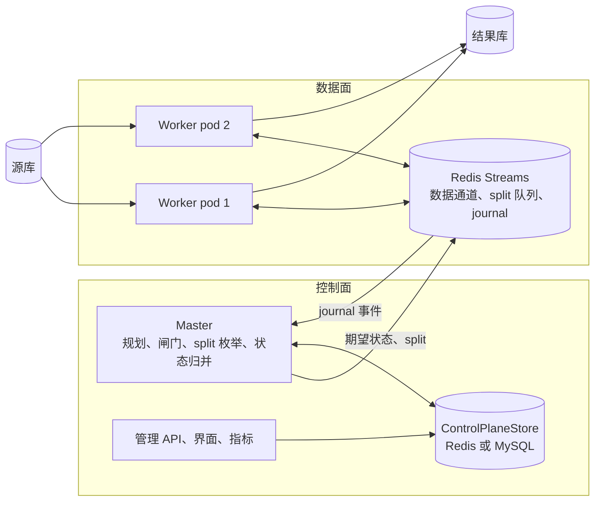
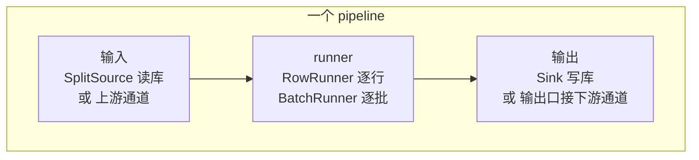
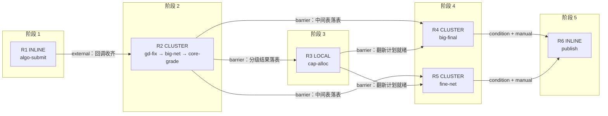
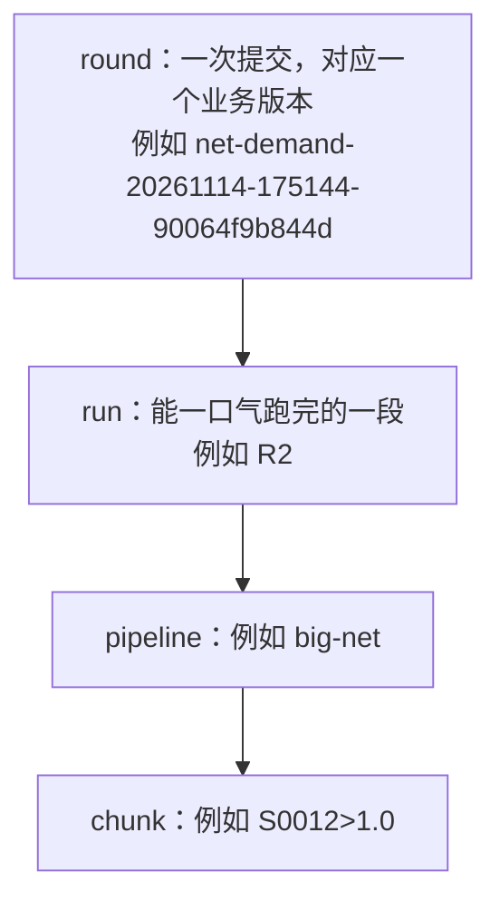
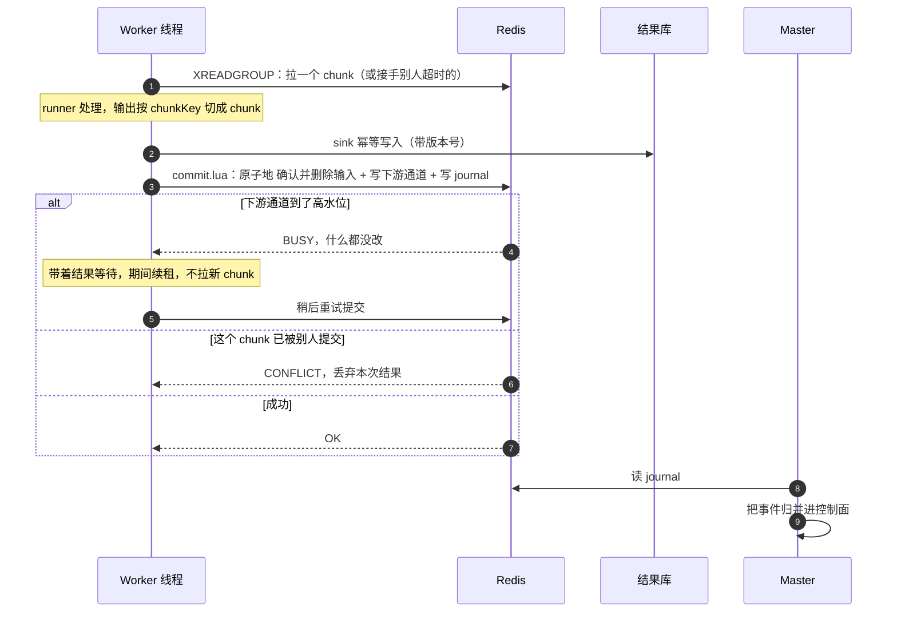

# 技术原理

这一页讲 pipeliner 内部是怎么工作的：一张图如何变成执行计划，master 和 worker 如何分工，数据和状态各自放在哪里。读者是想弄懂框架、排查问题或者改框架代码的人。只想用它的话，看 [使用指南](./user-guide.md) 就够了。

读完这一页后，有两个专题值得接着读：[一致性与容错](./consistency.md) 和 [背压与流控](./backpressure.md)。

## 目录

- [1. 核心模型：有界的流](#1-核心模型有界的流)
- [2. 整体架构](#2-整体架构)
- [3. pipeline 与 chunk](#3-pipeline-与-chunk)
- [4. 从图到执行计划](#4-从图到执行计划)
- [5. 状态的层次](#5-状态的层次)
- [6. master：推进循环](#6-master推进循环)
- [7. worker：处理一个 chunk](#7-worker处理一个-chunk)
- [8. 事实在 Redis，记账在控制面](#8-事实在-redis记账在控制面)
- [9. 闸门](#9-闸门)
- [10. 设计取舍](#10-设计取舍)

## 1. 核心模型：有界的流

pipeliner 处理的是**有界**的数据：输入来自某个版本的快照，量是有限的，跑完就结束。它借用了流式计算的传输方式（边产边消、逐跳限速），但不做无界的实时计算，没有窗口、水印这些概念。

整个框架建立在几条约定上，后面每一节都是它们的展开：

1. 一个 pipeline 由三段组成：从哪读（source）、怎么算（runner）、写到哪（sink）。pipeline 之间用通道连接。
2. **chunk 是唯一的工作单位。** worker 一次拉一个 chunk，处理它，写出结果，三件事一起提交。传输、确认、重试、断点、监控都以 chunk 为粒度。
3. **runner 不保留跨 chunk 的状态。** 需要全量数据才能算的步骤，先把数据落表，过一道闸门，再由下一段重新读取。
4. 闸门和落表把图切开，切出来的每一块能一口气跑完，叫一个 **run**。
5. master 只做推进和记账，不碰业务数据；worker 只做拉取、计算、写出。master 没有内存状态，换一个 pod 接手可以从控制面完整恢复。

## 2. 整体架构



所有 pod 运行的是同一个应用，角色在运行时确定：

| 角色 | 谁来当 | 做什么 |
| --- | --- | --- |
| master | 抢到租约的那个 pod，同一时刻只有一个 | 每秒推进一次所有运行中的 round：判定闸门、启动 run、把 worker 的提交事件归并进控制面、监测背压 |
| worker | 每个 pod 都是，master 所在的 pod 默认也是 | 从通道拉 chunk，跑 runner，写 sink，提交 |

两类存储：

| 存储 | 放什么 | 实现 |
| --- | --- | --- |
| 数据面 | 流动中的数据：pipeline 之间的通道、待读的 split 队列、提交事件日志（journal）、死信 | Redis Streams，必需 |
| 控制面 | 状态：round、run、pipeline、chunk、闸门各自到了哪一步 | Redis（默认）或 MySQL，二选一 |

Redis 是硬依赖，因为分布式通道和提交事件都在 Redis Stream 上。MySQL 只在控制面选它时才需要。两者的区别主要在灾难恢复：控制面放 MySQL 时，即使 Redis 数据全丢，已完成的 run 也不受影响（见 [一致性与容错](./consistency.md#6-各种故障怎么恢复)）。

## 3. pipeline 与 chunk

### 3.1 三段结构



| 段 | 两种形态 | 说明 |
| --- | --- | --- |
| 输入 | `SplitSource` | master 把表切成若干 split，放进 split 队列；worker 领一个 split，按范围读库 |
| | 上游通道 | 用消费组读上游 pipeline 写出的 Redis Stream，一条记录就是一个 chunk |
| runner | `RowRunner` | 逐行处理：映射、过滤、展开 |
| | `BatchRunner` | 整个 chunk 一起处理：批量查库、滚动计算 |
| 输出 | `Sink` | 幂等地写 MySQL、ClickHouse 或外部系统 |
| | 输出口（port） | 把结果切成 chunk 写入下游通道。一个 runner 可以有多个命名输出口，用来分叉 |

不管哪种输入，worker 最终都是从一条 Redis Stream 领活：读通道领的是数据，读库领的是 split 描述。所以确认、超时回收、多 pod 分摊、完成判定只需要实现一套。

### 3.2 chunk 的编号是推出来的

chunk 的 id 不是随机生成的，而是从血缘推出来的：

| chunk | id 示例 | 规则 |
| --- | --- | --- |
| 源 chunk | `S0012` | split 的序号 |
| 下游 chunk | `S0012>2.0` | 上游 chunk id + `>` + 边的序号 + `.` + 输出序号 |
| 交给 sink 的 chunk | `S0012#fine` | 输入 chunk id + `#` + 输出口名 |

同一个输入重放，产出的 chunk id 不变。这是幂等写库和去重的基础：重试写出的是"同一个 chunk"，而不是一批无法辨认的新数据。

### 3.3 chunk 对业务键封闭

很多业务计算要求同一组数据同时在场。比如净需求的逐月滚动，要求一个料号的全部节点、全部月份在同一批里。框架用 `chunkKey` 保证这一点：

- 输出切 chunk 时，边界只落在 key 组之间，**一个 key 组永远不会被切开**。超过大小上限的大组整组保留。
- runner 的输出必须按 `chunkKey` 分组；同一个 key 在组结束后再次出现，框架直接报错，而不是悄悄切开。
- 源头切 split 时按同一个键哈希，保证同键同 split。

runner 需要的其他数据（库存、在途）用 `ctx.lookup()` 按本 chunk 的键批量查快照表，框架不做流与流的 join。

跨键的全局计算不满足封闭性，例如所有料号共用的产能。这类步骤要先落表，下一段换一种切法再读，也就是下一节的"物化边"。

## 4. 从图到执行计划

### 4.1 三种边

| 边 | 怎么声明 | 性质 |
| --- | --- | --- |
| 流边 | `.edge(from, to)` | 上下游同时运行，数据边产边消 |
| 物化边 | 不用声明。一个 pipeline 读的 dataset 正好是另一个 pipeline 写的，框架自动识别 | 上游写完，下游才能开始读 |
| 闸门边 | `.gate(...).after(...).before(...)` | 条件成立，下游才能开始 |

### 4.2 规划步骤

`plan()` 把图变成不可变的 `ExecutionPlan`：

1. **校验。** 图必须无环；每个流输出口有且只有一个下游；标识符合法。
2. **给边分类。** 每条物化边自动生成一道 `barrier:<dataset>` 闸门。
3. **求区域。** 去掉物化边和闸门边，只看流边，求连通分量。一个连通分量里的 pipeline 必须同时运行。
4. **合并成 run。** 准入条件（入闸集合）相同的区域合并为一个 run，因为它们会在同一时刻被放行。
5. **死锁检查。** 一道闸门的两端不能落在同一个 run 里，否则下游不启动就不消费，上游被背压堵住永远完不成。
6. **排阶段。** run 之间的依赖是一张无环图，按拓扑分层得到阶段，同一阶段的 run 可以并行。
7. **选执行模式**（见 4.3）。
8. **冻结。** 计算计划的 hash，随 round 一起存进控制面。断点续跑时比对 hash，图变了就拒绝续跑。

以示例的净需求图为例：8 个 pipeline、2 条流边、4 道手写闸门，规划后得到 6 个 run、5 个阶段、8 道闸门。



R2 里的三个 pipeline 由流边相连，所以在同一个 run 里同时运行。`core-grade` 写出的分级结果被 `cap-alloc` 读取，这是一条物化边，于是在这里切开。

### 4.3 三种执行模式

| 模式 | 适用的 run | 通道 | 线程与 pod | 断点粒度 |
| --- | --- | --- | --- | --- |
| `INLINE` | 一条直链，数据量小 | 直接方法调用，没有队列 | 单 pod 单线程 | 整个 run |
| `LOCAL` | 有分叉或合流，数据量中等 | JVM 内有界队列 | 单 pod，每个 pipeline 一个线程 | 整个 run |
| `CLUSTER` | 数据量大 | Redis Stream | 多 pod，每个 pipeline 按并行度起线程 | 每个 chunk |

模式可以用 `.mode()` 指定；没指定时按预估行数选择。三种模式下 runner 的代码完全一样，runner 拿到的行的值类型也被规范成同一组，所以换模式不需要改业务代码。

`INLINE` 和 `LOCAL` 的断点粒度粗，是因为内存里的数据会随进程一起丢失。所以它们只适合重跑成本低的 run。

## 5. 状态的层次

一次提交从外到内分四层，另加闸门：



| 层 | 状态 | 谁改 |
| --- | --- | --- |
| round | `CREATED → RUNNING → SUCCEEDED / FAILED / CANCELLED`，可 `PAUSED` | master |
| run | `PENDING → RUNNING → SUCCEEDED / FAILED` | master |
| pipeline | `PENDING → RUNNING → SUCCEEDED / FAILED` | master |
| chunk | `PENDING → DONE / DEAD / SKIPPED` | worker 产生事件，master 归并 |
| gate | `CLOSED → OPEN / REJECTED / TIMEOUT` | master |

失败向上传播：chunk 进死信，所属 pipeline 失败，所属 run 失败，round 失败。与失败的 run 没有依赖关系的其他 run 会跑完，不会被中断。

同一个业务键（`bizKey`，比如计划版本号）重复提交，返回已有的那一轮，不会重复计算。

## 6. master：推进循环

### 6.1 选主

所有 pod 启动后都尝试 `SET pg:leader <podId> NX PX <ttl>`，成功的成为 master，并在每次推进时续租。每次当选都会拿到一个新的、更大的**任期号**（epoch），之后它的每一次写入都带着这个号。任期号如何让旧 master 失效，见 [一致性与容错](./consistency.md#3-第一道防线任期号与-fencing)。

### 6.2 一次推进做什么

master 每秒跑一遍下面的循环：

```text
续租；执行管理命令队列里的命令（暂停、重跑、放行……）
for round in 运行中的 round:
    对这个 round 做 fencing，失败说明已被新 master 取代，退位
    读 journal，把 chunk 事件连同读到的位置一起归并进控制面，然后裁剪 journal
    对每道 CLOSED 的闸门：条件满足 → OPEN
    对每个 PENDING 的 run：入闸全部 OPEN → 建通道、枚举 split、发布期望状态 → RUNNING
    对每个 RUNNING 的 pipeline：判定是否完成 → SUCCEEDED / FAILED
    对每个 RUNNING 的 run：pipeline 全部成功且行数对账通过 → SUCCEEDED，清理通道
采样背压指标，检查 worker 心跳，周期性清理历史数据
```

关键在于**每一步都是"读当前状态，条件更新"**。重复执行没有副作用，执行到一半崩溃也没关系：下一任 master 从控制面读出同样的状态，接着往下推。master 自己不需要记住任何东西。

一次推进就是一次 `engine.tick()` 调用。默认由 pod 内的线程每秒调一次；也可以关掉这个线程，由 xxl-job 之类的外部调度器通过 `POST /pg/master/tick` 来触发，租约、任期号这些语义都不变。

### 6.3 怎么知道一个 pipeline 跑完了

流式系统通常要靠"结束标记"在通道里传递来判断完成，pipeliner 不需要：

- worker 提交 chunk 时，会在同一个脚本里把这条输入记录从流里**删掉**。所以输入流的长度恰好等于"还没处理完的 chunk 数"。
- 一个 `CLUSTER` pipeline 完成的条件是：上游都已成功（对源 pipeline 来说是 split 已全部入队），输入流长度为 0，并且 journal 已经归并到末尾。
- 源 pipeline 还多一个条件：每个 split 对应的 chunk 记录都已离开 `PENDING`。因为队列为空的那一刻，可能还有 split 正在投递途中。

`INLINE` 和 `LOCAL` 的 run 没有 Redis 通道，由执行它的 pod 跑完后往 journal 写一条"本地 run 完成"事件。

最后还有一道**行数对账**：每条流边上，上游提交的输出行数之和必须等于下游提交的输入行数之和。对不上，run 置为失败并告警。

## 7. worker：处理一个 chunk

### 7.1 按需启动

master 启动一个 run 时，只是把"哪些 pipeline 该运行、各自多少并行度"写成**期望状态**。每个 pod 上的 agent 每秒读一次，在本地增减线程。pipeline 的 runner 实例也是这时候才创建，run 结束就释放，所以一个 pod 上只有正在它上面运行的 pipeline 才占内存。

### 7.2 分压不需要调度

一个 pipeline 在所有 pod 上的线程，都以不同的消费者名加入同一个 Redis 消费组，竞争拉取同一条流。谁有空谁拉，处理慢的 pod 自然拉得少。master 不需要决定"哪个 chunk 给哪个 pod"。源 pipeline 的 split 队列也是同一套机制。

### 7.3 一个 chunk 的一生



几个保护机制：

| 情况 | 处理 |
| --- | --- |
| chunk 处理时间很长 | worker 每 20 秒续租一次（默认值，可配置） |
| pod 挂了，手上的 chunk 没人管 | 超过 60 秒没续租，被别的 worker 用 `XAUTOCLAIM` 接手 |
| 处理抛异常 | 同一个 worker 重试，默认总共 3 次 |
| 反复失败或反复被接手 | 转入死信流，状态记为 `DEAD`，等待人工重试或跳过 |
| 写库先于提交，提交前崩溃 | chunk 被重放，再写一次同样的数据；写入是幂等的，结果不变 |

## 8. 事实在 Redis，记账在控制面

chunk 的提交必须和"确认输入、写下游"是同一个原子操作，而 Redis 和 MySQL 之间做不到原子。所以拆成两步：

1. worker 在 `commit.lua` 里把提交事件写进 **journal** 流。这一步和数据提交是原子的，是事实的唯一来源。
2. master 读 journal，把事件批量、幂等地写进控制面。控制面里的 chunk 状态是 journal 的投影，会晚几百毫秒。

读到哪了（位点）**存在控制面里，和事件的效果在同一个事务（或同一个 Lua 脚本）里写入**。这样"事件已应用"和"位点已前进"永远不会分离：master 在两者之间崩溃，新 master 从控制面里的位点继续，既不丢事件也不重复应用。

这个设计带来两个好处：两种控制面存储的实现都很薄；worker 不直接写 MySQL，MySQL 的写入量由 master 攒批控制。

Redis 里的 key 都以 `pg:{<roundId>}:` 开头，带上 run 的尝试次数（attempt）。重跑一个 run 时 attempt 加 1，新旧两次尝试用的是不同的通道，互不干扰。完整的 key 布局见 [设计文档 10.5](./pipelinegraph-design.md#105-redis-key-布局)。

## 9. 闸门

闸门是 run 之间的等待点，只由 master 判定，状态存在控制面，所以 master 切换或集群重启都不会丢。

| 类型 | 放行条件 | 典型用途 |
| --- | --- | --- |
| `barrier` | 指定的上游 pipeline 都已成功 | 物化边自动生成；也可以手写，表达框架看不到的依赖 |
| `condition` | 用户提供的判定函数返回放行，master 定时轮询 | 数据校验、行数检查 |
| `external` | 外部系统的回调收齐 | 异步调用外部算法 |
| `manual` | 有人在管理界面或 API 上放行 | 发布前审批 |
| `timer` | 到达指定时间，或等待一段时长 | 等业务库日切 |

两个设计点：

- **按状态判定，不按事件触发。** 外部信号先写进控制面，master 每次推进时按当前状态重新判断。所以信号早到、重复到、到的时候 master 正好不在线，都不影响结果。
- **每道闸门都有超时策略。** `FAIL`：闸门超时，下游失败。`OPEN_WITH_FALLBACK`：放行并打上兜底标记，下游 runner 可以通过 `ctx.gateFallback(gateId)` 读到它，走兜底逻辑。`ALERT_AND_WAIT`：告警后继续等。

`external` 闸门按批次号清点回调。批次号由框架签发，全局唯一，并且带着尝试次数：重跑之后，上一次尝试迟到的回调不会被算进来。细节见 [一致性与容错](./consistency.md#5-外部系统批次号)。

## 10. 设计取舍

| 选择 | 换来了什么 | 付出了什么 |
| --- | --- | --- |
| 只做有界数据 | 不需要结束标记、窗口、水印；完成判定就是"流空了" | 不能做无界实时流 |
| runner 无跨 chunk 状态 | 任何 chunk 都可以单独重放；不需要状态快照 | 全局计算必须先落表再读，多一次读写 |
| 不做流内 join | 模型简单，chunk 自包含 | 关联数据要用 `lookup` 查快照表 |
| master 无状态、每步幂等 | 随时可以换主，不需要主备同步 | 每次推进都要读控制面 |
| 事实先写 Redis，再归并 | 提交是原子的；MySQL 写入可攒批 | 控制面状态晚几百毫秒 |
| 写库先于提交 | 不需要分布式事务 | sink 必须幂等；目标表需要版本列 |
| 用 Lua 脚本保证原子 | 实现简单可靠 | 只支持单机 Redis，不支持 Redis Cluster |

---

**下一步**：[一致性与容错](./consistency.md) 讲为什么杀掉任何 pod 结果都对；[背压与流控](./backpressure.md) 讲上游快、下游慢时发生什么。
