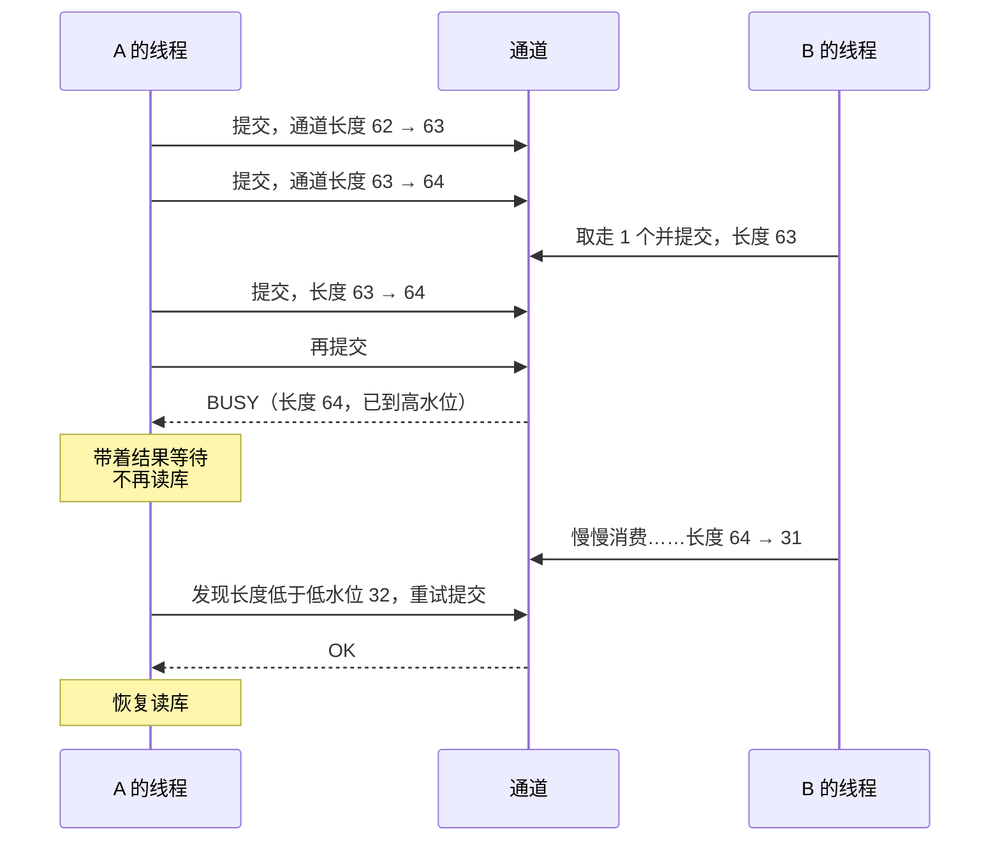

# 背压与流控

这一页回答一个问题：**上游读库很快，下游计算很慢，中间的 Redis 会不会被撑爆？上游怎么知道该停下来，又怎么知道可以继续？**

读者是想了解流控机制、调水位参数，或者排查"为什么这个 pipeline 不动了"的人。建议先读 [技术原理](./architecture.md)。

## 目录

- [1. 场景](#1-场景)
- [2. 三层防护一览](#2-三层防护一览)
- [3. 第一层：一个线程只拿一个 chunk](#3-第一层一个线程只拿一个-chunk)
- [4. 第二层：通道水位](#4-第二层通道水位)
- [5. 第三层：master 的全局监测](#5-第三层master-的全局监测)
- [6. 怎么观察](#6-怎么观察)
- [7. 参数](#7-参数)
- [8. 实测数据](#8-实测数据)

## 1. 场景

两个 pipeline 用一条流边连着：A 从 ClickHouse 读数据写进通道，B 从通道拉数据、计算、落库。


如果没有流控，A 会一口气把整张表读出来塞进 Redis，Redis 的内存随之暴涨。pipeliner 的处理方式一句话概括：**B 消费不动，A 的提交就被拒绝；A 提交不了，就不再读库。**

## 2. 三层防护一览

worker 是主动拉取的，没拉走的数据留在 Redis 里，所以 worker 自己不会被"推"爆。真正的风险有两处：worker 进程里同时持有的数据太多；Redis 里的通道无限增长。

| 层 | 防的是什么 | 机制 |
| --- | --- | --- |
| 进程内 | worker 的内存 | 一个线程同一时刻只持有一个输入 chunk |
| 通道 | 单条通道的积压 | 高低水位：到了高水位，上游的提交被拒绝 |
| 全局 | 整个 Redis 的内存 | master 监测内存，超限时暂停所有读库的 pipeline |

## 3. 第一层：一个线程只拿一个 chunk

每个 pipeline 线程拉一个 chunk，处理，提交，然后才拉下一个。上一个没提交成功，就不会去拉新的。所以单个 pod 的内存上限可以直接估算：

```text
内存上限 ≈ Σ（各 pipeline 的线程数 × 最大 chunk 大小 × 反序列化膨胀系数）
```

输出切 chunk 时受行数和字节数两个上限约束（`chunkRows`、`chunkBytes`）。有一个例外：`chunkKey` 相同的一组行不会被拆开，遇到超大的组，chunk 会超过上限，估算内存时要按最大的组来算。

> [!WARNING]
> 读库的 pipeline 会把**一个 split 整个读进内存**再切 chunk。split 切得太粗（比如只按 3 个站点切，每个 split 上百万行），单个线程就会占用几个 GB。压测里出现过这种情况，见 [压测报告](./benchmark.md)。解决办法是换更细的切分键，或者调大 `hashSplit` 的份数。

## 4. 第二层：通道水位

### 4.1 机制

每条通道有高水位和低水位，默认是 64 和 32 个 chunk。提交脚本 `commit.lua` 在写下游之前先看下游通道的长度：

```text
commit.lua：
    任何一条输出通道的长度 >= 高水位？ → 返回 BUSY，什么都不改
    否则：确认输入 + 写输出 + 写 journal，返回 OK
```

拿到 `BUSY` 的线程带着已经算好的结果原地等待，每 200 毫秒看一次，等所有输出通道都降到**低水位以下**才重试提交。等待期间它不拉新 chunk，手上那个 chunk 的租约由续租线程保持。

用两个水位而不是一个，是为了避免在临界点反复启停：涨到 64 才停，降到 32 才放，一停一放之间有足够的间隔。

### 4.2 回到那个场景



对 Redis 来说，这条通道里始终只有几十个 chunk，和源表有多大无关。

### 4.3 压力逐跳回传

链路更长时，压力是一跳一跳往回传的。以示例里的 `gd-fix → big-net → core-grade` 为例，最慢的是末端的 `core-grade`：


`big-net` 拿到 `BUSY` 后不再拉取，它自己的输入通道开始积压，于是 `gd-fix` 也拿到 `BUSY`，最终停止读库。`core-grade` 快起来之后，压力按相反的顺序逐级解除。

整个过程没有任何"通知"：上游不需要知道下游是谁、有多慢，它只看自己要写的那条通道满没满。

### 4.4 高水位是软上限

水位检查发生在提交之前，一次提交会把一个输入 chunk 的**全部输出**一起写进去。所以通道的实际长度可能超过高水位，超出量最多是一次提交的输出 chunk 数。

对流到流的 pipeline，一个输入 chunk 通常只产出一两个输出 chunk，超出可以忽略。对读库的 pipeline 就不一样了：一个 split 的全部输出是一次提交。

```text
一次提交的输出 chunk 数 ≈ split 的行数 ÷ chunkRows
通道长度上限           ≈ 高水位 + 这个数
```

压测里能直接看到这个效应：`gd-fix` 的一个 split 在 4 万物料时要往下游输出约 8 万行，按 800 行切成约 100 个 chunk，所以它的输出通道峰值到了 138 到 150，而不是 64。这不是背压失效，Redis 内存峰值仍然只有 59 MB。但如果想让积压更贴近水位线，就把 split 切细一些。

### 4.5 落库慢的情况

写数据库的 sink 是同步调用。数据库慢了，线程就阻塞在写入上，自然不会去拉新的 chunk，效果和拿到 `BUSY` 一样，不需要额外的机制。

### 4.6 `LOCAL` 模式

`LOCAL` 模式的 run 不经过 Redis，pipeline 之间用 JVM 内的有界队列连接（容量由 `local-queue-capacity` 决定）。队列满了，上游线程的写入就阻塞，这是同一个思路在进程内的实现。

## 5. 第三层：master 的全局监测

master 每次推进时采样各通道的长度，并据此做三件事。

### 5.1 给瓶颈加线程

| 观察到的情况 | 判断 | 动作 |
| --- | --- | --- |
| 某个 pipeline 的输入通道到了高水位，而它的输出通道没满 | 它就是瓶颈 | 把它的并行度加 1，各 pod 自动多起一个线程 |
| 某个 pipeline 的输出通道满了 | 它是被下游拖住的，根因不在它 | 不处理 |

每个 pipeline 两次扩容之间有冷却时间（默认 15 秒），并行度不超过上限（默认 8）。扩容只在一轮计算内有效，下一轮从配置的并行度重新开始。

### 5.2 Redis 内存限流

如果配置了 `redis-memory-limit-bytes`，master 每次推进时读取 Redis 的 `used_memory`：

- 达到上限：设置全局限流标志，**所有读库的 pipeline 暂停拉取新的 split**，并打告警日志。流到流的 pipeline 不受影响，继续把通道里已有的数据消化掉。
- 回落到上限的 80% 以下：解除限流。

限流标志带过期时间，限流期间由 master 不断续期。master 如果在限流期间挂了，标志会自己过期，不会留下一个永远解不开的限流。

这一层是最后的保险。正常情况下第二层已经把每条通道限制在水位附近，整个 Redis 的占用大致是"通道数 × 水位 × chunk 大小"，不会涨到需要全局限流的程度。

### 5.3 停滞告警

如果通道里最老的那个 chunk 长时间没有被处理，也没有人续租或接手，master 会发出停滞告警，附上 chunk 和持有它的 pod。这通常意味着卡死或者坏数据。

## 6. 怎么观察

| 途径 | 看什么 |
| --- | --- |
| 管理界面 `/pg-ui/` | 流边上标着通道的当前长度，到了高水位会变红 |
| `GET /pg/rounds/{id}/backpressure` | 各通道的长度、水位，以及当前被判定为瓶颈的 pipeline |
| 指标 `pipeliner.channel.length` | 各通道长度 |
| 指标 `pipeliner.busy.wait` | 各 pipeline 因为 `BUSY` 等待的累计时间。这个值大的 pipeline 是**被拖住**的，瓶颈在它的下游 |
| 指标 `pipeliner.oldest.pending` | 通道里最老的 chunk 等了多久 |
| 指标 `pipeliner.redis.used.memory` | Redis 内存 |
| 告警 `PipelinerBackpressureSustained` | 某条通道持续处于高水位约 10 分钟 |
| 告警 `PipelinerRedisMemoryHigh`、`PipelinerStalledChunk` | 内存过高；chunk 停滞 |

读法：顺着流的方向找，**最后一个输入通道满、而输出通道不满的 pipeline 就是瓶颈**。它上游的所有 pipeline 都会显示 `BUSY` 等待，那是结果，不是原因。

上面是 Micrometer 的指标名；导出到 Prometheus 后点号变成下划线，并带上单位后缀（例如 `pipeliner_busy_wait_seconds_total`）。完整列表见 [运维手册](./operations.md)。

## 7. 参数

都在 `pipeliner.runtime.*` 下。

| 参数 | 默认 | 含义 |
| --- | --- | --- |
| `high-watermark` | 64 | 通道长度达到它，上游的提交返回 `BUSY` |
| `low-watermark` | 32 | 被拒的上游等通道降到它以下才重试。要求 `0 < low ≤ high` |
| `autoscale` | true | 是否自动给瓶颈 pipeline 加并行度 |
| `max-parallelism` | 8 | 自动扩容的上限 |
| `autoscale-cooldown-millis` | 15000 | 同一个 pipeline 两次扩容的最小间隔 |
| `redis-memory-limit-bytes` | 0 | Redis 内存上限，0 表示不启用全局限流 |
| `local-queue-capacity` | 64 | `LOCAL` 模式下 pipeline 之间的队列容量 |

调参的方向：

- **Redis 内存紧张**：调低水位，减小 `chunkRows`，把 split 切细。
- **吞吐不够、通道经常是空的**：瓶颈在上游或源库，调水位没有用。
- **吞吐不够、某条通道经常是满的**：瓶颈是它的下游 pipeline，提高那个 pipeline 的并行度，或者看它写的数据库是不是慢。

## 8. 实测数据

下面的数字来自 [压测报告](./benchmark.md)，水位用的是默认值 64 / 32。

| 场景 | 每阶段流过的行数 | Redis 内存峰值 | 通道长度峰值 |
| --- | ---: | ---: | ---: |
| 3,000 物料，3 个 pod | 24 万 | 18 MB | 18 |
| 12,000 物料，6 个 pod | 96 万 | 32 MB | 89 |
| 40,000 物料，6 个 pod | 320 万 | 59 MB | 138 |

数据量涨了 13 倍，Redis 内存只涨了 3 倍多，绝对值始终是几十 MB。通道峰值超过 64 的原因见 [4.4](#44-高水位是软上限)。

同一组测试里，`big-net` 累计的 `BUSY` 等待时间最长（4 万物料时各线程合计约 317 秒），说明它一直被下游的 `core-grade` 拖着：`core-grade` 是这条链路的瓶颈。

---

**下一步**：[压测报告](./benchmark.md) 有完整的数据和瓶颈分析；[配置参考](./configuration.md) 有全部参数。
