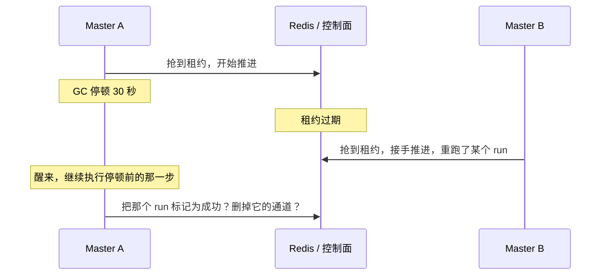
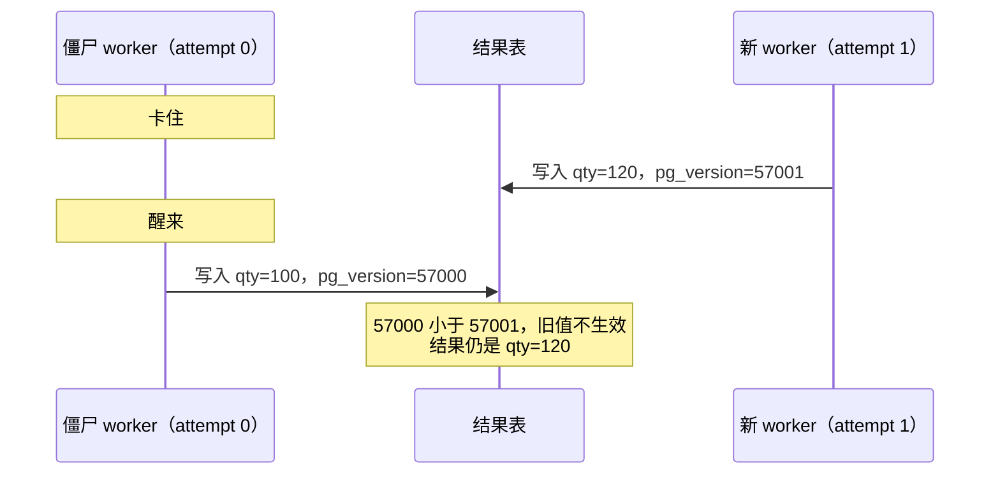

# 一致性与容错

这一页回答一个问题：**为什么随便杀掉哪个 pod，甚至把整个集群重启，算出来的结果都和没出故障时一样？**

读者是想确认框架靠不靠得住的人，以及排查数据问题的人。建议先读 [技术原理](./architecture.md)。

## 目录

- [1. 保证什么](#1-保证什么)
- [2. 原子提交](#2-原子提交)
- [3. 第一道防线：任期号与 fencing](#3-第一道防线任期号与-fencing)
- [4. 第二道防线：尝试次数与版本化写入](#4-第二道防线尝试次数与版本化写入)
- [5. 外部系统：批次号](#5-外部系统批次号)
- [6. 各种故障怎么恢复](#6-各种故障怎么恢复)
- [7. 人工操作也是原子的](#7-人工操作也是原子的)
- [8. 怎么验证的](#8-怎么验证的)
- [9. 边界与前提](#9-边界与前提)

## 1. 保证什么

| 路径 | 语义 | 靠什么 |
| --- | --- | --- |
| pipeline 到 pipeline（流到流） | 恰好一次 | 确认输入和写出结果在同一个 Lua 脚本里，要么都发生，要么都不发生 |
| pipeline 到数据库 | 至少一次投递 + 幂等写入，效果等同于恰好一次 | 写库先于提交；提交前崩溃会重放这个 chunk，再写一次同样的数据 |
| pipeline 到外部接口 | 同上，要求对方按批次号幂等 | 框架签发全局唯一的批次号 |

分布式系统里真正难的不是"进程死了"，而是"进程没死，但它以为自己还管事"：一个被 GC 或虚拟机暂停卡住几十秒的进程，醒来后会继续执行卡住之前的那行代码。这种进程叫**僵尸**。下面的机制大多是为了对付它。

## 2. 原子提交

worker 处理完一个 chunk 后，执行一个 Lua 脚本 `commit.lua`。Redis 保证脚本内的操作是原子的：

```text
commit.lua：
    下游通道到了高水位？           → 返回 BUSY，什么都不改
    这条输入还归我吗？             → 不归我（已被别人接手并提交）则返回 CONFLICT，什么都不改
    确认并删除输入记录（XACK + XDEL）
    把输出的 chunk 写进下游通道（XADD）
    把提交事件写进 journal（XADD）
    返回 OK
```

由此得到三个性质：

- **不会丢。** 输入被确认之前，它一直留在流的待确认列表里。worker 崩溃，别的 worker 超时后接手。
- **不会重。** 两个 worker 同时处理了同一个 chunk（比如其中一个卡住后被接手，又醒过来），只有一个的提交会成功，另一个拿到 `CONFLICT`，丢弃自己的结果。
- **状态不会和数据脱节。** 提交事件和数据在同一个脚本里写入，master 之后据此记账（见 [技术原理第 8 节](./architecture.md#8-事实在-redis记账在控制面)）。

续租也要检查归属：worker 只能给仍然归自己的 chunk 续租，不能从接手它的 worker 手里抢回来。

## 3. 第一道防线：任期号与 fencing

这一节对付**僵尸 master**。

### 3.1 问题



如果 A 的最后那次写入成功了，B 刚刚做的事就被破坏了。租约本身挡不住它，因为 A 检查租约是在停顿之前。

### 3.2 做法

1. **每次当选都拿一个更大的任期号。** master 当选时取 `epoch`，之后的每一次写入都带着它。
2. **每个 round 记着"管过我的最大任期号"。** master 推进一个 round 之前，先在控制面和数据面各做一次 fencing：把这个 round 记的任期号抬到自己的号。如果 round 上记的号已经比自己大，说明有更新的 master 接手了，自己立刻退位。
3. **每次写入都校验。** 控制面的每次 master 写入，都在同一个事务（MySQL）或同一个脚本（Redis）里校验"round 记的任期号不高于我的"。数据面的每次 master 写入（发布期望状态、入队 split、删 key、裁剪 journal 等）也在 Lua 里做同样的校验。

于是上图里 A 醒来后的那次写入会被拒绝：B 已经把 round 的任期号抬高了。**冻结后恢复的旧 master 什么也改不了。**

管理操作（暂停、重跑、放行闸门等）不由收到请求的 pod 直接执行，而是写进一个命令队列，由 master 在推进时用自己的任期号执行。所以所有对状态的修改都出自持有有效任期号的那一个进程。

### 3.3 任期号本身不能回退

任期号存在 Redis 里。如果 Redis 的数据丢了，计数器从 1 重新开始，而控制面里各个 round 记的号更大，新 master 的所有写入都会被自己拒绝。为此有两层保护：

- **下限。** 取新任期号时，以控制面里已有的最大值为下限，保证新号一定更大。
- **先登记再使用。** 新号在使用之前，先在控制面里做一次原子的登记（比较后写入）。两个 master 万一拿到同一个号，只有一个登记成功，另一个本轮不当 master。

给写库排序用的 round 序号（见下一节）也用同样的办法保护，而且它是单独持久化的，历史 round 被清理之后也不会回退。

## 4. 第二道防线：尝试次数与版本化写入

这一节对付**僵尸 worker**，以及一切"迟到的写入"。

### 4.1 问题

worker 写数据库这一步在提交之前，而且数据库不认识任期号。考虑这个场景：某个 run 被重跑了，但旧的那次执行里还有一个卡住的 worker 线程，它醒来后把手上的旧结果写进了结果表，覆盖了重跑算出的新结果。

### 4.2 尝试次数（attempt）

每个 run 有一个尝试次数，重跑一次加 1。它出现在三个地方：

| 位置 | 作用 |
| --- | --- |
| Redis 的 key（通道、split 队列、死信）都带 attempt | 新旧两次尝试用的是不同的流，旧线程的提交写不进新通道 |
| journal 事件带 attempt | 与当前 attempt 不符的事件被 master 丢弃 |
| worker 按 (round, pipeline, attempt) 管理线程和 runner 实例 | attempt 变化后，旧线程做完手上的 chunk 就退出，新线程用全新的实例 |

### 4.3 版本化写入

每次写库都带一个版本号：

```text
pg_version = round 的全局序号 × 1000 + run 的 attempt
```

round 的序号在提交时分配，全局单调递增。所以更晚的 round、同一 round 里更晚的尝试，版本号一定更大。写入时只允许新版本覆盖旧版本：

| 目标 | 做法 |
| --- | --- |
| MySQL | 条件 upsert：`INSERT ... ON DUPLICATE KEY UPDATE c = IF(VALUES(pg_version) >= pg_version, VALUES(c), c)`，唯一键是业务键 |
| ClickHouse | 表引擎用 `ReplacingMergeTree(pg_version)`，排序键是业务键；读取时带 `FINAL` |



用法上只需要在 sink 上声明版本列：`JdbcSinks.mysql(...).versionColumn("pg_version")`，表里加一个 `pg_version BIGINT` 列。

> [!NOTE]
> 因为版本号里留给 attempt 的只有三位，一个 run 的尝试次数必须小于 1000。到达上限时框架会拒绝再重跑，并给出明确的错误。

### 4.4 幂等的前提：确定性

"重放写出同样的数据"成立，需要三件事是确定的，框架都做了保证或检查：

- **切分是确定的。** 同一份快照，两次枚举得到同样的 split；按 `chunkKey` 切 chunk 的结果也是确定的。
- **编号是确定的。** chunk id 由血缘推出（见 [技术原理 3.2](./architecture.md#32-chunk-的编号是推出来的)）。
- **值的类型是确定的。** runner 写进行里的值被规范成固定的一组类型（整数、十进制数、字符串、布尔、列表、映射），三种执行模式下看到的一样，重放前后也一样。

runner 自己也必须是确定的：同样的输入 chunk 产出同样的结果。这要求 runner 只读锁定了版本的快照数据，不读"当前时间""随机数"这类每次都变的东西。

## 5. 外部系统：批次号

调用外部系统（比如一个异步算法服务）时，重放会导致重复调用。框架为每次调用签发批次号，要求对方按批次号去重：

```text
<roundId>:<pipelineId>:<chunkId>@<attempt>
例：net-demand-20261114-175144-90064f9b844d:algo-submit:S0003#out@0
```

在 sink 里用 `ctx.batchId(chunk)` 取得，不要自己拼。四个部分各有用处：

| 部分 | 没有它会怎样 |
| --- | --- |
| roundId | chunk id 在每一轮里都相同（`S0003` 每个月都是 `S0003`），下个月的请求会被对方当成重复请求，拿到上个月的结果 |
| pipelineId | 每个源 pipeline 都从 `S0000` 开始编号，同一轮里两个 pipeline 会撞号 |
| chunkId | 用来区分批次 |
| attempt | 重跑之后应当重新计算，批次号必须变；同时让闸门能分辨迟到的旧回调 |

外部回调通过 `external` 闸门接收。`Gates.externalCountOf(pipelineId)` 的放行条件是：**当前 attempt 里，每一个真正调用过 sink 的 chunk，回调都到了**。

- 上一次尝试迟到的回调在写入前就被拒绝，不会让闸门提前放行。
- 按 chunk 去重计数，同一个 chunk 的重复回调只算一次。
- 输出为空的 chunk 不会调用 sink，也就不计入期望的回调数，闸门不会空等。

## 6. 各种故障怎么恢复

| 故障 | 恢复方式 | 重做的范围 |
| --- | --- | --- |
| worker 线程抛异常 | 同一个 chunk 重试；次数用完进死信 | 一个 chunk |
| worker pod 挂掉 | 它没提交的 chunk 超时后被别的 worker 接手 | 该 pod 手上的 chunk |
| 坏数据反复失败 | 进死信，run 失败。修复后 `retry` 把死信放回通道，或 `skip` 跳过并把结果标为不完整 | 死信里的 chunk |
| master 挂掉 | 新 master 当选，从控制面加载状态，从记录的位点继续归并 journal | 无，worker 在此期间照常处理 |
| master 在枚举 split 中途挂掉 | 新 master 重新枚举，已入队的 split 被跳过 | 无 |
| 旧 master 冻结后醒来 | fencing 让它的写入全部失败，它退位 | 无 |
| 整个集群重启 | 通道和 journal 靠 Redis 持久化保留，状态在控制面，启动后继续 | 未提交的 chunk |
| `INLINE` / `LOCAL` 的 run 所在 pod 挂掉 | master 把这个 run 派给另一个 pod | 这一个 run |
| Redis 主从切换，丢了最后约 1 秒的写入 | 通道和 journal 一起回退到同一时间点，被回退的 chunk 重新处理；行数对账兜底 | 最后约 1 秒提交的 chunk |
| Redis 数据全丢，控制面在 MySQL | 已成功的 run 不受影响。任期号和 round 序号由控制面里的下限兜底。运行中的 run 被检测出"数据面丢失"并置为失败，需要人工 `rerunFrom` | 未完成的 run |
| Redis 数据全丢，控制面也在 Redis | 控制面一起丢 | 整轮重新提交 |

最后的兜底是 run 的边界：run 与 run 之间交接的都是落了表的数据。**只要上游的表还在，任何一个 run 都可以单独重跑。**

## 7. 人工操作也是原子的

| 操作 | 效果 |
| --- | --- |
| 暂停 / 恢复 | 暂停后 worker 做完手上的 chunk 就停止拉取；恢复后从通道里剩下的继续 |
| `retry`（重试 run） | 把失败 run 的死信放回通道，继续跑。先放回再改状态，中途失败时 run 仍是失败状态，再执行一次即可补完 |
| `rerunFrom`（从某个 run 重跑） | 一次原子操作里，把这个 run 和它的所有下游 run、相关的 pipeline、chunk 记录、闸门及其信号一起复位，attempt 加 1 |
| `skip`（跳过死信） | 把死信标记为跳过，run 可以继续，round 的结果打上"不完整"标记 |
| 放行闸门 | 默认要求闸门上游的 run 都已成功；强制放行需要显式指定 |

`rerunFrom` 的复位在 MySQL 里是一个事务，在 Redis 里是一个 Lua 脚本，不会出现"run 复位了，闸门没复位"的中间状态。数据面里旧 attempt 留下的 key，由 master 在之后的推进中幂等地清理。

操作会被拒绝的情形（例如对已取消的 round 重试）见 [运维手册](./operations.md)。

## 8. 怎么验证的

上面这些机制都有对应的测试，脚本在 `pipeliner-example/scripts/`：

| 测试 | 方法 | 验证的性质 |
| --- | --- | --- |
| 存储契约测试 | 同一套测试跑在 Redis、MySQL 和内存三种控制面实现上 | 三种实现在 fencing、原子复位、幂等归并上行为一致 |
| `e2e.sh` | 3 个 pod，计算中途 `kill -9` 一个 worker 和 master | 结果的校验和与无故障的一轮相同 |
| `restart-resume.sh` | 计算中途 `kill -9` 全部 pod，再重启 | 断点续跑，校验和相同 |
| `chaos.sh` | 4 个 pod，每轮两个 round 并发；随机强杀、`SIGSTOP` 冻结 master 或 worker 再唤醒（制造僵尸）、暂停与恢复 | 每个 round 的校验和与单线程基线相同；没有重复行；没有残留的旧版本数据 |
| `chaos-admin.sh` | 重跑、重试、取消后重新提交等管理操作，与上述故障同时发生 | 同上；被冻结的旧尝试写不进新结果；不留残余 key |

校验和是对结果表每一行的业务列做与顺序无关的哈希，再加上行数和数量合计。它不包含版本列，所以"结果一致"指的是业务数据逐行相同。

## 9. 边界与前提

框架的保证建立在这些前提上，使用时需要满足：

- **结果表能按业务键做幂等写入**，并且有版本列。
- **ClickHouse 的每一个会影响结果的读取都带 `FINAL`**（`useFinal()`），否则可能读到合并前的旧版本行。
- **runner 是确定的**，只读锁定版本的快照。
- **外部系统按批次号幂等**。

已知的边界：

- 管理命令被 master 取出后、执行过程中 master 宕机，这条命令的结果未知。客户端会收到"结果未知"，需要先查看 round 状态再决定是否重试。
- Redis 数据全丢之后，运行中的 run 不会自动重跑，只会被检测出来并置为失败。

---

**下一步**：[背压与流控](./backpressure.md)；或者回到 [技术原理](./architecture.md)。
