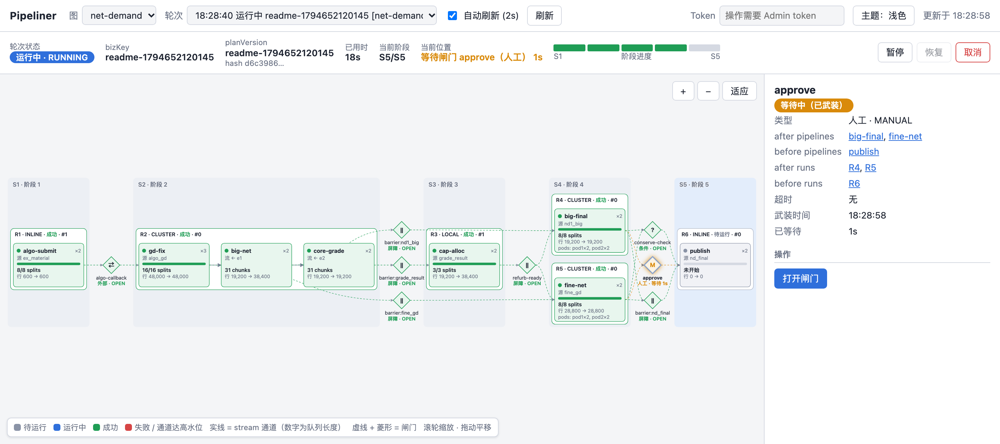

# 运维手册

本页面向运行和值守 pipeliner 集群的运维人员：管理 REST 接口和每个操作的规则、内置 Web 界面、认证与审计、外部触发 master 推进、数据保留、指标与告警、故障恢复手册，以及已知限制。部署参数见[配置参考](./configuration.md)，各概念（run、gate、attempt 等）见[使用指南](./user-guide.md#核心概念)。

- [管理接口 REST API](#管理接口-rest-api)
- [管理操作规则](#管理操作规则)
- [可视化界面](#可视化界面)
- [认证与授权](#认证与授权)
- [外部触发 master 推进](#外部触发-master-推进)
- [数据保留](#数据保留)
- [指标与告警](#指标与告警)
- [故障与恢复手册](#故障与恢复手册)
- [已知限制](#已知限制)

## 管理接口 REST API

基础路径 `/pg`，由 `PipelinerAdminController` 提供（`pipeliner.admin.enabled=false` 时不注册）。在下面的命令里：

```bash
export BASE=http://localhost:8081                    # 任意一个 pod
export PG_ADMIN_TOKEN=...                            # ADMIN token，变更类接口需要
AUTH=(-H "Authorization: Bearer $PG_ADMIN_TOKEN")
```

### 接口一览

| 方法 | 路径 | 参数 / body | 说明 |
|---|---|---|---|
| GET | `/pg/graphs` | | 已注册的图名列表 |
| GET | `/pg/graphs/{name}/plan` | | 执行计划，`text/plain`（run、stage、模式、闸门）。未知图返回 404。 |
| GET | `/pg/graphs/{name}/plan.json` | | 结构化执行计划（runs / pipelines / channels / gates），供界面使用。未知图返回 404。 |
| POST | `/pg/rounds` | body：`{"graph":"...","bizKey":"...","params":{}}` | 提交一个 round，返回 `{"roundId":"..."}`。`graph` 和 `bizKey` 必填，缺失返回 400；`params` 的值会转成字符串。对同一个 `(graph, bizKey)` 重复提交返回已有的 `roundId`。未知图返回 404。 |
| GET | `/pg/rounds` | `graph`（可选）、`limit`（默认 20，超出 1..200 的值被夹到这个范围，不报错） | 最近的 round：未结束的在前，其余按创建时间倒序。每项含 `roundId`、`graph`、`bizKey`、`status`、`createdAt`、`startedAt`、`finishedAt`、`incomplete`、`compacted`、`params`。 |
| GET | `/pg/rounds/{id}` | | round 的完整状态：`round`、`runs`、`gates`、`pipelines`、`chunkCounts`（按 pipeline 和状态）、`rowsIn`、`rowsOut`。未知 round 返回 404。 |
| GET | `/pg/rounds/{id}/chunks` | `pipeline`、`status`（`PENDING` / `DONE` / `DEAD` / `SKIPPED`）、`limit`（默认 100，范围 1..1000）、`offset`（默认 0，≥ 0） | chunk 记录列表，按 `pipelineId`、`chunkId` 排序。非法值返回 400。被压缩的 round 返回空列表。 |
| GET | `/pg/rounds/{id}/channels` | | 各通道当前长度：`e1`、`e2`…（stream 边）、`split:<pipeline>`（源的 split 队列）、`dlq:<pipeline>`（死信队列）。只包含状态为 RUNNING 或 FAILED 的 CLUSTER run。 |
| GET | `/pg/rounds/{id}/backpressure` | | `highWatermark`、`lowWatermark`、`channels`（同上）、`bottlenecks`（输入积压达到高水位、而输出通道没满的 pipeline）。未知 round 返回 404。 |
| POST | `/pg/rounds/{id}/pause` | | 暂停：worker 做完手上的 chunk 就停止拉取。 |
| POST | `/pg/rounds/{id}/resume` | | 恢复。 |
| POST | `/pg/rounds/{id}/cancel` | | 取消，清理数据面。 |
| POST | `/pg/runs/{roundId}/{runId}/retry` | | 重试失败的 run（`retryRun`）。 |
| POST | `/pg/runs/{roundId}/{runId}/rerun` | | 从该 run 起重跑（`rerunFrom`）。 |
| POST | `/pg/runs/{roundId}/{runId}/skip` | | 跳过死信（`skipDeadLetters`）。 |
| POST | `/pg/gates/{roundId}/{gateId}/signal` | body：`{"key":"...","payload":"..."}` | 向 external 闸门发信号。`key` 必填，长度 1..512，否则 400；`payload` 缺省为空串。过时回调被忽略，仍返回 ok。 |
| POST | `/pg/gates/{roundId}/{gateId}/open` | `operator`（默认 `admin`，仅鉴权关闭时使用）、`force`（默认 `false`） | 打开 `CLOSED` 的闸门。 |
| POST | `/pg/master/tick` | | 执行一次 master 推进，返回 `TickResult`，见[外部触发 master 推进](#外部触发-master-推进)。 |
| GET | `/pg/cluster` | | 当前 pod：`podId`、`isLeader`、`liveInstances`（本 pod 上已实例化的 pipeline：`roundId`、`pipelineId`、`threads`、`perThread`、`runner`、`attempt`）。 |
| GET | `/pg/cluster/workers` | | 所有存活的 pod（心跳未超过 `worker-dead-millis`）：`podId`、`leader`（是否持有租约）、`heartbeatAgeMillis`、`instances`（每项 `round`、`pipeline`、`attempt`、`threads`，来自心跳，每个 pod 最多 200 项）。 |

除 `submit` 和 `master/tick` 外，成功的变更类调用返回 `{"status":"ok"}`；`/pg/rounds/{id}/channels` 和 `/chunks` 对不存在的 round 不报 404，而是返回空对象 / 空列表。

```bash
curl "${AUTH[@]}" -H 'content-type: application/json' \
     -d '{"graph":"net-demand","bizKey":"b1"}' $BASE/pg/rounds
curl $BASE/pg/rounds/$RID
curl "$BASE/pg/rounds/$RID/chunks?pipeline=gd-fix&status=DEAD&limit=20"
curl "${AUTH[@]}" -X POST $BASE/pg/rounds/$RID/pause
curl "${AUTH[@]}" -X POST "$BASE/pg/gates/$RID/approve/open?force=true"
```

### 错误响应

错误的响应体是 `{"error": "<简短消息>"}`：

| 状态码 | 情形 |
|---|---|
| 400 | 参数类型错误或缺失、坏 JSON、`limit` / `offset` / `key` 越界、`status` 不是合法值 |
| 401 | 缺失或未知的 token（带 `WWW-Authenticate: Bearer`） |
| 403 | `VIEWER` 做变更，或没有配置任何 token 时做变更 |
| 404 | 未知的 round / graph / run / gate |
| 415 | 不支持的请求体媒体类型 |
| 500 | 其他异常；响应里只带简短消息（非预期异常只给异常类型），完整堆栈在服务端日志 |

## 管理操作规则

`pause` / `resume` / `cancel` / `retry` / `rerun` / `skip` / `openGate` 都不在接收请求的 pod 上直接执行，而是写入 leader 的**命令队列**，由 leader 在 tick 里用自己的 epoch 执行（对应 `PipelinerEngine` 上的 `pause`、`resume`、`cancel`、`retryRun`、`rerunFrom`、`skipDeadLetters`、`openGate`）。调用在 leader 执行完才返回，失败抛 `PipelinerException`，HTTP 返回错误消息。leader 每个 tick 最多执行 20 条命令。

### 命令超时与撤回

- **命令 id 与截止时间**：每条命令带随机 `id` 和 `deadline = 提交时间 + admin-timeout-millis`。leader 每次只取出一条命令，取出前先确认自己仍是 leader（被取代 / 租约丢失时剩下的命令留在队列里给下一任，不会丢）。已过截止时间的命令不执行，结果记为 `expired`（`ok=false`）。
- **撤回**：客户端等待超时后，先把命令从队列里**撤回**。撤回成功就保证没有被执行，错误消息写明 `withdrawn (not executed)`。
- **结果未知**：撤回失败说明 leader 已经取走命令，再宽限等待 2 秒；仍无结果时报 `outcome is unknown`。此时**先查 round 状态再决定是否重试**。
- 命令结果保存 10 分钟。
- `external` 模式下命令在下一次 tick 才执行，`admin-timeout-millis` 必须大于外部触发间隔。

### 各操作的规则

- **未知 round** 是普通错误（404），不会让 leader 退位。leader 若发现自己已被更新的 epoch 取代（round 级 fence 失败），命令返回 `leader deposed ... retry` 并退位，队列里其余命令不受影响。
- **plan hash 检查**：round 创建时的 plan hash 与 leader 上注册的同名图不一致时（滚动发布中途），`rerunFrom`、`retryRun`、`skipDeadLetters`、`cancel`、`openGate` 直接拒绝，错误为 `was created under a different plan version`，等发布完成后再操作。`pause` / `resume` 不做这个检查。
- **`pause` / `resume`**：`pause` 只对 `CREATED` / `RUNNING` 的 round 生效，`resume` 只对 `PAUSED` 的 round 生效，其他状态下是空操作。
- **`cancel`**：终态的 round 是空操作。取消后 round 变 `CANCELLED`（不可恢复，不能再 `retry` / `rerun`），并清理该 round 所有 attempt 的通道、死信和 journal。
- **`retryRun`** 的拒绝条件：
  - round 已 `CANCELLED`；
  - round 已被压缩（用 `rerunFrom`）；
  - run 的某个 in-gate 不是 `OPEN`（`TIMEOUT` / `REJECTED` 说明 run 是因闸门失败的：用 `rerunFrom` 重跑上游 run，它会把闸门复位；`openGate` 只能打开 `CLOSED` 的闸门，对 `TIMEOUT` / `REJECTED` 的闸门无效）；
  - run 不是 `FAILED` 时只记 WARN 并返回，不做任何事。

  CLUSTER run：先（带 fence）把当前 attempt 的死信放回通道，再做控制面迁移（`FAILED → RUNNING` 的 CAS，清掉 error 和 `finishedAt`，保留 `startedAt`）；中途失败时 run 仍是 `FAILED`，重新发出 `retry` 即可补完（空死信队列的 requeue 是空操作）。LOCAL / INLINE run 以新 attempt 整体重放。
- **`skipDeadLetters`** 的拒绝条件：除上面各项外，LOCAL / INLINE run 不支持（用 `retryRun` / `rerunFrom`）；run 没有任何死信（`DEAD` 记录和当前死信队列都为 0）时拒绝。执行顺序：先把 journal 排空（迟到的 `DEAD` 事件不会复活被跳过的 chunk），再在控制面把 `DEAD` 标记为 `SKIPPED`、把 round 标记为 `incomplete`（带 epoch，被取代的 leader 写不进去），再恢复 run 和 pipeline，最后清空死信队列。被跳过的 chunk 的数据**不会**进入结果，所以 round 带 `incomplete` 标记，且 run 完成时不做行数对账。
- **`rerunFrom`**：一次原子的 `resetRuns`：该 run 和所有下游 run、它们的 pipeline、chunk 记录、相关闸门（连同信号）一起复位，复位的 run 的 attempt 加 1，round 回到 `RUNNING`，`incomplete` 标记清除。加 1 后 attempt 会达到 1000 的拒绝（先于任何修改），`CANCELLED` 的 round 拒绝。数据面旧 attempt 的 key 由 master 在启动新 attempt 时幂等清理。对被压缩的 round 也可以用，压缩标记和相关汇总会一并清除，重新结束后会再次压缩。
- **`openGate`**：只能打开 `CLOSED` 的闸门（已 `OPEN` / `TIMEOUT` / `REJECTED` 的闸门，以及未知闸门，都返回错误）。默认要求闸门所有 after-run 已 `SUCCEEDED`，否则拒绝并提示 `pass force=true`；`force=true` 只跳过这个检查，仍要求闸门是 `CLOSED`。操作人取自认证身份（token 名），仅在鉴权关闭时才使用 `operator` 参数。

## 可视化界面



每个 pod 都在 `http://<pod>:<port>/pg-ui/` 提供内置界面：纯静态页面，没有构建步骤、没有外部依赖，内网可用。界面所在的路径在 `/pg` 之外，**不经过**认证拦截器；它调用的 `/pg/*` 接口仍然受认证保护。

**展示什么**：

- 选定图的拓扑：按 stage 分列，run 是框，pipeline 是节点，stream 边上标通道长度（达到高水位时变红），闸门是菱形，自动 barrier 标 `barrier:<dataset>`。支持拖动平移、滚轮缩放、「适应」按钮。
- 所选 round 的实时状态：round 摘要（状态、当前阶段、用时、`incomplete` / `compacted`）、各 run / pipeline / 闸门的状态、source 的 `done/total splits`、行数、死信（DLQ）数、各 pod 持有的线程数。不选 round 时只显示拓扑。
- 点击 pipeline / run / 闸门打开侧栏：详情、失败（`DEAD`）的 chunk，以及操作按钮：重试、从此处重跑、跳过死信、打开闸门，以及暂停 / 恢复 / 取消 round。每个操作执行前有确认框，失败时显示服务端返回的错误。

> [!NOTE]
> 界面的「打开闸门」按钮调用 `.../open?operator=ui`，**不带 `force`**。闸门的 after-run 还没全部成功时它会被服务端拒绝；需要强制打开请用 REST 接口加 `force=true`。

**使用**：

- 自动刷新：所选 round 没有结束时每 2 秒轮询一次，round 列表每 6 秒刷新一次；可以在顶栏关闭。
- 深链：`/pg-ui/?graph=<图>&round=<roundId>`；可加 `&theme=dark|light` 指定主题，加 `&sel=pipeline:<id>`（也可以是 `run:` 或 `gate:`）预先选中一个对象。
- Token：右上角输入框，只保存在浏览器的 `sessionStorage`，每个 `/pg` 请求都以 `X-PG-Token` 头发送（服务端始终接受这个头，与 `header` 配置无关）。读取默认免 token；所有操作按钮需要 `ADMIN` token；服务端配了 `read-requires-token` 时读取也需要，界面会明确提示 401 / 403。
- pod 持有的实例来自心跳（`heartbeat-millis`，默认 5 秒），所以略有延迟。

**开关**：`pipeliner.admin.ui.enabled`（默认 `true`）。设为 `false` 后 `/pg-ui` 和 `/pg-ui/**` 返回 404；`pipeliner.admin.enabled=false` 则关闭 `/pg` 接口本身，界面没有数据可看。

## 认证与授权

`/pg/*` 由 Spring MVC 拦截器 `AdminSecurityInterceptor`（包 `io.github.amwtke.pipeliner.spring.security`，不依赖 Spring Security）保护，默认开启。它守护 `PipelinerAdminController` 的所有处理器，以及 DispatcherServlet 内 `/pg` 下的路径，所以 `spring.mvc.servlet.path` 或 context path 改变后依然生效。配置项见[配置参考](./configuration.md#管理接口与界面配置)。

**角色**：`ADMIN` 可调用所有接口；`VIEWER` 只能读。

**规则**：

- `GET` / `HEAD` 默认免 token；所有变更方法（`POST` / `PUT` / `PATCH` / `DELETE`）只允许 `ADMIN`，包括 `POST /pg/master/tick`。`OPTIONS` 总是放行。
- `pipeliner.admin.security.read-requires-token: true` 时，读也需要 `VIEWER` 或 `ADMIN` token。
- 开启但**没有配置任何 token** 时，启动打一条 WARN，所有变更接口返回 `403`（只读仍可用）。
- 缺失或未知的 token 返回 `401`（带 `WWW-Authenticate: Bearer`），`VIEWER` 做变更返回 `403`，响应体是 `{"error": "..."}`。
- token 用常量时间比较；配置的 token 会 trim（首尾或内部有空白时打 WARN）；短于 16 个字符会 WARN（仍然可用）。

**传递方式**：`Authorization: Bearer <token>`，或者 `X-PG-Token: <token>`。`pipeliner.admin.security.header` 可以改默认的 `Authorization` 头名（改成别的名字后，值可以是裸 token 或 `Bearer <token>`）；`X-PG-Token` 始终被接受。

```yaml
pipeliner:
  admin:
    security:
      enabled: true            # 默认 true；false 则完全不注册拦截器（此时 openGate 的 operator 取自参数）
      read-requires-token: false
      header: Authorization
      tokens:
        - {name: ops,    token: "${PG_ADMIN_TOKEN}",  role: ADMIN}
        - {name: viewer, token: "${PG_VIEWER_TOKEN}", role: VIEWER}
```

```bash
curl -H "Authorization: Bearer $PG_ADMIN_TOKEN" -X POST localhost:8080/pg/rounds/$RID/pause
curl -H "X-PG-Token: $PG_ADMIN_TOKEN" -H 'content-type: application/json' \
     -d '{"graph":"net-demand","bizKey":"b1"}' localhost:8080/pg/rounds
```

### 审计日志

每次变更调用写一行 INFO，logger 名 `pipeliner.audit`，格式：

```text
principal=ops method=POST path=/pg/rounds/r1/pause round=r1 run/gate=- status=200
```

`run/gate` 一栏对 run 操作写成 `run=<runId>`，对闸门操作写成 `gate=<gateId>`，round 级操作写成 `run/gate=-`；`status` 是操作最终的 HTTP 状态码。**被拦截器拒绝的变更调用**也会审计，格式是 `principal=<名字或 anonymous> method=... path=... status=401|403 rejected="<原因>" remote=<客户端地址>`。日志里不会出现 token。`POST /pg/master/tick` 每次调用不审计（它按秒触发），只有被拒绝时才审计。

> [!WARNING]
> 示例应用的 dev token（`dev-admin-token-change-me`、`dev-viewer-token-change-me`）仅供本地，务必用 `PG_ADMIN_TOKEN` / `PG_VIEWER_TOKEN` 覆盖。示例的 `/demo/*` 接口**不经过**此拦截器、没有认证，Actuator 端点同样不在保护范围内：请用 `management.server.port` 单独监听内网端口，或由平台层保护。

## 外部触发 master 推进

master 的一次推进（续租 / 抢主、执行管理命令、推进所有活跃 round、保留清理、内存限流）是一个显式、幂等的操作：`PipelinerEngine.tick()`，返回 `TickResult`。默认（`local` 模式）由每个 pod 内部的 `pg-master` 线程每 `tick-millis` 调用一次；也可以改成 `external`，由 xxl-job 之类的外部调度器驱动，此时 pod 不启动 master 线程。

| 属性 | 默认 | 说明 |
|---|---|---|
| `pipeliner.runtime.master-tick-mode` | `local` | `local` = 内部线程；`external` = 不起线程，由外部调用 `engine.tick()` 或 `POST /pg/master/tick` |
| `pipeliner.runtime.external-tick-interval-millis` | `2000` | 预期的外部触发间隔，仅用于校验和告警：`leader-ttl-millis < 3 ×` 该值时启动打 WARN。运行期相邻两次 tick 的间隔超过 `leader-ttl-millis / 2` 时也打 WARN（每分钟最多一条） |

`TickResult` 的字段：`leader`、`epoch`、`roundsTicked`、`commandsExecuted`、`durationMillis`、`skipped`、`skipReason`、`error`。

**语义**：

- leader 语义不变：租约、每次（重新）获得 leadership 取新 epoch、round 级 fencing。非 leader 的 tick 在尝试抢租约后返回 `skipped`，`skipReason="not leader"`。同一 pod 上并发的 tick 由锁保护，后到者返回 `skipped "tick in progress"`；`master-enabled=false` 返回 `skipped "master disabled"`。
- worker 心跳和 agent 在任何模式下都是本地线程：pod 的存活判定不依赖调度器。
- **lease keeper**：`external` 模式下每个 pod 有一个轻量的本地 `pg-lease-keeper` 线程，**仅当本 pod 是 leader** 时每约 `leader-ttl-millis / 3` 续一次租约（限流生效时同时刷新全局限流标志的 TTL）。它不抢主、不推进 round、不执行命令。所以 leader 一旦产生，就不会因为触发间隔抖动、或随机路由落到别的 pod 而丢租约；抢主（取新 epoch）仍由外部 tick 触发，leader 宕机后需要一次落到其他 pod 的 tick 来接管（租约到期之后）。
- 管理命令在下一次 tick 才执行，延迟最长约一个触发间隔；round 的推进粒度同样变成触发间隔：间隔越大越省资源，但闸门、run 的切换越慢。建议 1–5 秒。

**路由建议**：任何路由策略都可用，只有持有租约的 pod 会推进，其余 pod 返回 `not leader`（无副作用）。推荐 FAILOVER 或 RANDOM，触发间隔 1–5 秒，且 `leader-ttl-millis > 3 ×` 触发间隔；避免会长期固定到已死 pod 的策略。

xxl-job 处理器示例（仅示例，框架不依赖 xxl-job）：

```java
@XxlJob("pipelinerTick")
public void pipelinerTick() {
    TickResult r = engine.tick();
    XxlJobHelper.log(r.toString());
}
```

HTTP 方式：调度器直接请求任意存活 pod：

```bash
curl -X POST -H "Authorization: Bearer $PG_ADMIN_TOKEN" http://<pod>:8080/pg/master/tick
# {"leader":true,"epoch":7,"roundsTicked":1,"commandsExecuted":0,"durationMillis":12,"skipped":false,"skipReason":null,"error":null}
```

该接口是变更类接口，需要 `ADMIN` token；始终返回 200，是否推进看 `skipped`；Redis / 存储等基础设施故障时同样返回 200，`skipped=true`、`skipReason="error"`，`error` 字段带简短原因（外部调度器把非 2xx 当作任务失败，所以不用 5xx）。

监控：`pipeliner_master_last_tick_timestamp_seconds`（每次完成的 leader tick 更新）、`pipeliner_master_tick_duration_seconds`，以及告警 `PipelinerMasterNotTicking`，见[指标与告警](#指标与告警)。

> [!NOTE]
> `restart-resume.sh`、`chaos.sh` 不支持 `external` 模式（没有人触发 tick）。只有 `e2e.sh` 会启动 `tick-loop.sh`：`MASTER_TICK=external pipeliner-example/scripts/e2e.sh`。

## 数据保留

控制面数据（round / run / gate / pipeline / chunk 记录）默认存在 Redis，不清理会一直增长。leader 在 master 循环里按 `interval-minutes` 周期执行一次保留任务（非 leader 不跑；每一遍最多处理 `batch` 个 round，并有很短的时间预算，不拖长 tick）。配置见[配置参考](./configuration.md#数据保留配置)。

| 动作 | 条件 | 做什么 |
|---|---|---|
| **压缩**（compact） | 终态（`SUCCEEDED` / `FAILED` / `CANCELLED`）round，`finishedAt` 早于 `chunk-days` 天前，且尚未压缩 | 把每个 pipeline 的汇总（各状态 chunk 数、`rowsIn`、`rowsOut`）写到 pipeline 记录上，再删除该 round 的全部 chunk 记录和计数器，标记 round 已压缩。压缩后 `GET /pg/rounds/{id}` 的 chunk 统计仍来自汇总，`/chunks` 列表为空，`retryRun` 和 `skipDeadLetters` 被拒绝（用 `rerunFrom`）。 |
| **删除**（purge） | 终态 round，`finishedAt` 早于 `round-days` 天前 | 删除 round、run、gate、信号、pipeline、chunk、计数器、`bizKey` 索引和排序索引，之后同一个 `bizKey` 可以重新提交。数据面残留的 key（失败 round 为了 retry 保留的通道和死信队列）也一并清理；`pg:workers` 里超过 `10 × worker-dead-millis` 没有心跳的成员也被清理。 |

要点：

- **数据面清理不会泄漏**：`purgeRounds` 在删除控制面记录的同一个原子步骤里，把 round id 写进存储侧的持久待清理集合（MySQL 表 `pg_pending_purge`，Redis `pg:store:pendingpurge`）；保留任务每一遍读出它，调用数据面的 `purgeRoundData`，成功后才清除。所以数据面清理失败、leader 切换或重启，都不会让 key 泄漏。数据面的 key 按 round 的 key 注册表 `pg:{r}:keys` 删除，不扫描整个 keyspace。
- **旧 round**：没有 key 注册表的 round（升级前创建的）会记入 `pg:purge:legacy`，再做有预算、可续跑的增量 `SCAN`（游标保存在 `pg:purge:legacycur`，任何 pod、重启后都从上次位置继续）。整个 keyspace 的扫描只发生在没有注册表的 round 上。
- **与并发重跑安全**：终态判断和删除是同一个原子步骤（MySQL：单事务内对 round 行 `SELECT ... FOR UPDATE`；Redis：单个 Lua）。`rerunFrom` / `retryRun` 把 round 改回 `RUNNING` 后，保留任务看到的就是非终态，不会删除。
- 每遍有变更时输出一行 INFO：`retention: purged N rounds, compacted M rounds (K chunk records), pruned W stale workers`。
- 指标：`pipeliner_retention_purged_rounds_total`、`pipeliner_retention_compacted_rounds_total`、`pipeliner_retention_last_run_timestamp_seconds`；告警 `PipelinerRetentionNotRunning`。

## 指标与告警

每个 pod 通过 Micrometer 暴露指标。示例应用已加入 `micrometer-registry-prometheus`，并在 `management.endpoints.web.exposure.include` 开放 `health,info,metrics,prometheus`：

```bash
curl -s localhost:8081/actuator/prometheus | grep '^pipeliner_'
```

自己的应用需要依赖 `spring-boot-starter-actuator` 和 `micrometer-registry-prometheus`，没有 `MeterRegistry` 时指标是空实现。

**基数约束**：计数器和计时器只带 `graph`、`pipeline`（以及 `run`、`status`、`gate`、`policy`）标签，**不带 round id**；带 `round` 标签的 gauge 在 round 结束、leader 退位、或 2 分钟没有刷新时从注册表移除。round id 到图名的映射在指标实现内部用有界 LRU 缓存解析，查不到时标签值是 `unknown`。

### 指标一览

| 指标 | 类型 | 标签 | 含义 |
|---|---|---|---|
| `pipeliner_chunks_processed_total` | counter | graph, pipeline, run | 处理完成的 chunk 数 |
| `pipeliner_chunk_duration_seconds` | timer | graph, pipeline, run | chunk 处理耗时 |
| `pipeliner_rows_in_total` | counter | graph, pipeline, run | 输入行数 |
| `pipeliner_rows_out_total` | counter | graph, pipeline, run | 输出行数 |
| `pipeliner_chunk_retries_total` | counter | graph, pipeline | chunk 重试次数 |
| `pipeliner_dead_letters_total` | counter | graph, pipeline | 进入死信的 chunk 数 |
| `pipeliner_busy_wait_seconds_total` | counter | graph, pipeline | 上游因下游满（`BUSY`）等待的秒数 |
| `pipeliner_channel_length` | gauge | graph, round, edge | 通道长度（leader 每个 tick 对运行中的 CLUSTER run 上报） |
| `pipeliner_channel_high_watermark` | gauge | 无 | 配置的高水位 |
| `pipeliner_gate_waiting_seconds` | gauge | graph, round, gate | 闸门布防后已等待的时长 |
| `pipeliner_gate_timeouts_total` | counter | graph, gate, policy | 闸门超时次数（`policy`：`FAIL` / `OPEN_WITH_FALLBACK` / `ALERT_AND_WAIT`） |
| `pipeliner_leader` | gauge | pod | `1` = 该 pod 是 leader |
| `pipeliner_leader_changes_total` | counter | 无 | 当选次数（每个进程启动时以 0 注册，所以首次当选也计入增量） |
| `pipeliner_master_last_tick_timestamp_seconds` | gauge | 无 | 最近一次完成的 leader tick 的时间（Unix 秒） |
| `pipeliner_master_tick_duration_seconds` | timer | 无 | leader tick 耗时 |
| `pipeliner_run_duration_seconds` | timer | graph, run, status | run 耗时（`status`：`SUCCEEDED` / `FAILED`） |
| `pipeliner_rounds_finished_total` | counter | graph, status | 结束的 round 数（`SUCCEEDED` / `FAILED` / `CANCELLED`） |
| `pipeliner_active_rounds` | gauge | 无 | 活跃 round 数（leader 上报，退位时归 0） |
| `pipeliner_live_instances` | gauge | pod | 该 pod 上存活的 pipeline 实例数 |
| `pipeliner_oldest_pending_seconds` | gauge | graph, round, pipeline | 输入 stream 里最老的待确认 chunk 的空闲时间 |
| `pipeliner_stalled_chunk_alerts_total` | counter | graph, pipeline | 停滞 chunk 告警次数 |
| `pipeliner_redis_used_memory_bytes` | gauge | 无 | Redis `used_memory`（leader 约每 10 秒采样；配置了内存上限时每个 tick 采样；退位后不再导出） |
| `pipeliner_retention_purged_rounds_total` | counter | 无 | 保留任务删除的 round 数 |
| `pipeliner_retention_compacted_rounds_total` | counter | 无 | 保留任务压缩的 round 数 |
| `pipeliner_retention_last_run_timestamp_seconds` | gauge | 无 | 保留任务上次运行的时间（Unix 秒） |

### 停滞 chunk 告警

master 每隔几个 tick（4 个）对 RUNNING 的 CLUSTER pipeline 的输入 stream（source 是 split 队列，其余是输入通道）做一次 `XPENDING`（汇总加最老一条的扩展查询，开销很小），把最老待确认条目的空闲时间写入 `pipeliner_oldest_pending_seconds`。空闲超过 `pipeliner.runtime.stalled-chunk-alert-millis`（默认 300000）时，对每个 `(round, pipeline, entry)` 只输出一条 WARN（`STALLED chunk: ...`，含 consumer、投递次数、待确认数），并让 `pipeliner_stalled_chunk_alerts_total` 加 1。

> [!NOTE]
> worker 正常存活时，claim 续租会不断重置空闲时间，所以这个告警抓的是「没人续租、没人接手」的条目（worker 卡死且续租线程也停了、没有存活 worker、autoclaim 被关闭等）。worker 线程卡在 runner 里但续租仍在运行的情况，需要另外通过 `pipeliner_chunk_duration_seconds` 或 run 耗时观察。

### Prometheus 告警规则

[`deploy/prometheus/pipeliner-alerts.yml`](../deploy/prometheus/pipeliner-alerts.yml)，在 Prometheus 配置的 `rule_files` 里引用。阈值是示例值（按默认水位 64 和 `stalled-chunk-alert-millis` 300000 给出），请按环境调整。

| 告警 | 触发条件 | 严重度 | 处理 |
|---|---|---|---|
| `PipelinerDeadLetters` | `increase(pipeliner_dead_letters_total[5m]) > 0` | warning | 见[死信](#出现死信) |
| `PipelinerRoundFailed` | `increase(pipeliner_rounds_finished_total{status="FAILED"}[5m]) > 0` | critical | `GET /pg/rounds/{id}` 看 run / gate 的状态和 `error`，再 `retry` / `rerun` |
| `PipelinerGateWaitingTooLong` | `pipeliner_gate_waiting_seconds > 3600`，持续 5 分钟 | warning | manual / external 闸门可能在等人或外部信号；有意长时间等待的闸门可按 `gate` 标签排除 |
| `PipelinerGateTimeout` | `increase(pipeliner_gate_timeouts_total[10m]) > 0` | warning | 见[闸门超时](#闸门超时) |
| `PipelinerStalledChunk` | `increase(pipeliner_stalled_chunk_alerts_total[10m]) > 0` | critical | master 日志里有对应的 `STALLED chunk` WARN；常见原因：worker 卡死或没有存活 worker |
| `PipelinerOldestPendingHigh` | `pipeliner_oldest_pending_seconds > 300`，持续 2 分钟 | warning | 同上，更早的预警 |
| `PipelinerBackpressureSustained` | `min_over_time(pipeliner_channel_length[10m]) >= 高水位`（无 `for:`） | warning | 通道 10 分钟都在高水位：看 `/backpressure` 的瓶颈 pipeline，考虑提高 `max-parallelism` 或检查下游 sink |
| `PipelinerNoLeader` | `sum(pipeliner_leader) < 1`，持续 1 分钟 | critical | 检查 Redis 连通性、pod 是否存活、`master-enabled` 是否被全部关闭 |
| `PipelinerMultipleLeaders` | `sum(pipeliner_leader) > 1`，持续 2 分钟 | warning | 短暂重叠可能是抓取时间差；持续存在说明有 pod 没感知到失去租约。fencing 保证数据正确，但需排查 |
| `PipelinerLeaderFlapping` | 近 10 分钟 leader 变更 > 3 次（或 `pipeliner_leader` 翻转 > 6 次） | warning | 检查 `leader-ttl-millis`、GC / 网络抖动、Redis 延迟 |
| `PipelinerRedisMemoryHigh` | `max(pipeliner_redis_used_memory_bytes) > 2 GiB`，持续 5 分钟 | warning | 2 GiB 只是示例；确认保留任务在运行；框架自身的限流见 `redis-memory-limit-bytes` |
| `PipelinerRetentionNotRunning` | 保留任务超过 1 小时没有运行（或指标缺失），持续 30 分钟 | info | 确认 `retention.enabled=true` 且有 leader；有意关闭保留时请屏蔽 |
| `PipelinerMasterNotTicking` | 有活跃 round（`pipeliner_active_rounds > 0`）而 60 秒内没有 leader tick，持续 1 分钟 | critical | LOCAL：检查是否有 leader；EXTERNAL：检查调度器是否在触发，以及 `leader-ttl-millis ≥ 3 ×` 触发间隔 |

`PipelinerMasterNotTicking` 的阈值取 `max(60s, 2 × scrape_interval + 5 × 预期 tick 间隔)`：样本最多比真实 tick 旧一个抓取间隔，再留一个抓取间隔的余量。60 秒适用于抓取间隔 ≤ 15 秒且 tick 间隔 ≤ 6 秒的情形，更大时按公式调大规则里的 60，并相应调整 `for:`。

## 故障与恢复手册

先用下面的命令看全局：

```bash
curl $BASE/pg/cluster/workers                    # 哪些 pod 存活，谁是 leader
curl "$BASE/pg/rounds?limit=20"                  # 最近的 round，未结束的在前
curl $BASE/pg/rounds/$RID                        # 单个 round 的 run / gate / chunk 状态和 error
```

### pod 挂了

| 情形 | 会发生什么 | 你需要做什么 |
|---|---|---|
| worker pod 被 `kill -9` / 宕机 | 它手上未提交的 chunk 留在待确认列表，空闲超过 `claim-idle-millis`（默认 60 秒）后被其他 worker `XAUTOCLAIM` 接手，从头重新处理这个 chunk（只重做这个 chunk）；一个 chunk 被投递超过 `max-deliveries` 次会直接进死信 | 通常无需处理；重启 pod 即可。关注 `pipeliner_chunk_retries_total`、死信 |
| leader 挂了 | 租约在 `leader-ttl-millis` 后过期，另一个 pod 抢到租约，取更高的 epoch，从控制面加载运行中的 round，从 journal 位点继续。worker 在此期间照常处理 chunk，只是 round 不推进、管理命令得不到执行 | 无需处理；观察 `PipelinerNoLeader`。`external` 模式要确保外部触发能到达存活 pod |
| LOCAL / INLINE run 所在的 pod 挂了 | master 在该 pod 心跳过期（`worker-dead-millis`）后把 run 分配给另一个 plan hash 一致的 pod，以新的 attempt 整体重放（sink 是版本化的，旧 attempt 的写入覆盖不了新的） | 无需处理；如果没有任何存活 pod 能执行该图，master 每个 tick 打 `no live worker able to run local run` 并重试 |
| 整个集群重启 | 通道和 journal 依赖 Redis 持久化保留，控制面在存储里；启动后继续跑，未提交的 chunk 重做。示例的 `restart-resume.sh` 验证了这一点 | Redis 要开启持久化（AOF），否则按下面的「Redis 数据丢失」处理 |
| 旧 leader 冻结后恢复（僵尸） | 它对控制面和数据面的所有写都会因 round 级 fence 失败，然后退位 | 无需处理；`PipelinerMultipleLeaders` 短暂触发属正常 |

### Redis 数据丢失

控制面默认也存在 Redis（`pipeliner.store.type: redis`），和数据面用的是同一个 `pipeliner.redis.uri`。

- **控制面是 Redis 时**，Redis 数据全丢（`FLUSHALL`、没有持久化的重启）意味着 round 记录也丢了，丢失的 round 需要重新提交。
- **控制面是 MySQL 时**，已成功的 run 不受影响；master 会重新登记活跃的 round，epoch 和 round 序号由存储里持久化的下限兜底，所以新 epoch 仍然大于用过的所有 epoch，新 round 的写入版本也不会低于 sink 表里已有的版本。
- **运行中的 CLUSTER run 会被判为失败**，不会自动重置。master 在两种情况下把该 pipeline 记为 `FAILED`，错误为 `data plane lost (...); rerunFrom required`，并打 `ERROR` 日志：
  - 源 pipeline 的 split 队列和 split 索引都没了，而 chunk 记录仍是 `PENDING`；
  - `RUNNING` 的 CLUSTER pipeline 的某个输入 stream 缺少消费组（stream 不存在或 `NOGROUP`）。

  处理：对该 run 调用 `rerunFrom`（`POST /pg/runs/{roundId}/{runId}/rerun`）。已成功的 run 不需要重跑。

### 出现死信

死信是 chunk 重试耗尽（`max-attempts` 次都失败，含 runner 抛异常、sink 写入失败）或投递次数超限（`max-deliveries`）后被移到 `dlq:<pipeline>` 的 chunk。一个 pipeline 有死信，pipeline 会 `FAILED`，所在 run 随之 `FAILED`。LOCAL / INLINE run 没有死信队列，chunk 重试耗尽直接让 run 失败。

1. 确认：告警 `PipelinerDeadLetters`；`GET /pg/rounds/{id}/channels` 里 `dlq:<pipeline>` 非零；`GET /pg/rounds/{id}/chunks?pipeline=<p>&status=DEAD` 看哪些 chunk、`error` 是什么。
2. 修复原因：数据问题或代码缺陷，或者外部依赖不可用。
3. 二选一：
   - **`retry`**：`POST /pg/runs/{roundId}/{runId}/retry`，把死信放回通道，run 继续跑。修复了原因再用，否则会再次进死信。
   - **`skip`**：`POST /pg/runs/{roundId}/{runId}/skip`，放弃这些 chunk，run 继续；round 被标记 `incomplete`，结果缺少被跳过的 chunk 的数据。只支持 CLUSTER run。

### 闸门超时

告警 `PipelinerGateTimeout`，`policy` 标签说明发生了什么：

- `FAIL`：闸门变 `TIMEOUT`，被它挡住的 run 变 `FAILED`，round 随后 `FAILED`。先确认闸门在等什么（`GET /pg/rounds/{id}` 的 `gates`：`type`、`armedAt`、`deadlineAt`）：
  - `manual`：没有人放行；
  - `external`：外部系统没有回调（`context` 里没有足够的信号），先修好外部系统；
  - `condition`：条件一直返回 `WAIT`。

  恢复：对闸门**上游**的 run 调用 `rerunFrom`，它会把闸门连同信号一起复位成 `CLOSED` 并重新布防。注意 `openGate` 对 `TIMEOUT` 的闸门无效，`retryRun` 会拒绝（in-gate 不是 `OPEN`）。如果是 external 闸门，重跑会用新的 attempt 重新向外部系统发起请求，旧 attempt 的回调会被当作过时回调忽略。
- `OPEN_WITH_FALLBACK`：闸门已带 `fallback` 放行，下游 runner 用 `ctx.gateFallback(gateId)` 走降级逻辑。检查下游结果是否可以接受，必要时 `rerunFrom`。
- `ALERT_AND_WAIT`：只是告警，闸门继续等待。可以等待条件满足；`CLOSED` 的闸门也可以用 `openGate` 放行（布防之后 after-run 都已成功，不需要 `force`）。

### 滚动发布与 plan hash

每个 round 在创建时记录图的 plan hash。master 遇到 plan hash 与本机注册的图不一致的 round 时，只打一条 WARN（`graph '...' not registered here or plan hash differs; master skips it`）并跳过它；管理命令也会拒绝（见[管理操作规则](#管理操作规则)）；LOCAL / INLINE run 只会分配给心跳里 plan hash 一致的 pod。所以滚动发布期间，如果 leader 还是旧版本，新版本创建的 round 不会被推进，直到 leader 切换或发布完成。尽快让所有 pod 的图一致。

## 已知限制

- **只支持单机 Redis**，不支持 Redis Cluster：Lua 脚本访问了没有在 `KEYS` 里声明的 key（全局 key、跨 round 的索引）。
- **LOCAL / INLINE 的 run 只在单个 pod 上执行**，不会分片到多个 pod；该 pod 挂了之后整体重放。
- **管理命令结果未知**：命令被 leader 取出后、执行中 leader 宕机，这条命令的结果未知（客户端等到宽限期后报 `outcome is unknown`，先查 round 状态再重试）。leader 每次只取一条命令，并在取出前确认自己仍是 leader，其余命令不会因为退位而丢失。
- **ClickHouse sink 的幂等依赖 `ReplacingMergeTree` 与 `FINAL` 读取**：不带 `FINAL` 的读取可能看到合并前的多个版本；`JdbcSinks.clickhouse` 不支持 `upsertKeys`。
- **`externalCountOf` 的期望回调数来自 chunk 记录里 sink 写出的行数**（MySQL 列 `pg_chunk.sink_rows`、Redis 计数器 `_sink`）：行数为 0 的 chunk 不调用 sink，也不计入期望。升级前已落库的 chunk 记录没有这个数值（按 0 计），所以跨升级进行中的 round，其 `externalCountOf` 闸门会少算期望数，需要时用 `openGate` 或 `rerunFrom` 处理。
- **Redis 数据面丢失后不会自动恢复运行中的 run**，只会检测并让它失败，需要人工 `rerunFrom`（见上）。
- **自动扩容只增不减**：并行度每次加 1，直到 `max-parallelism`；round 结束后随 run 结束而释放。
- 没有 Kafka source、HTTP sink；没有按 chunk 批量拉取（`pullBatch`），每个 worker 线程一次只处理一个 chunk。

## 下一步

- 配置项逐个说明：[配置参考](./configuration.md)
- 概念和图的写法：[使用指南](./user-guide.md)
- 一致性模型、fencing 与 attempt：[一致性](./consistency.md)；背压机制：[背压](./backpressure.md)
- 整体架构：[架构](./architecture.md)
