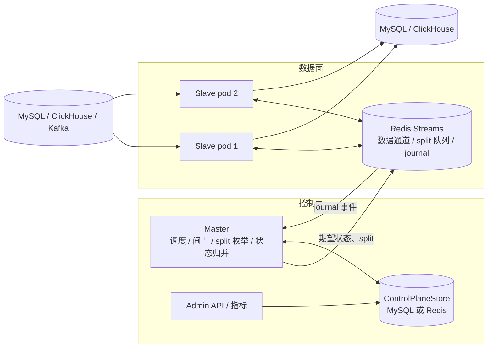
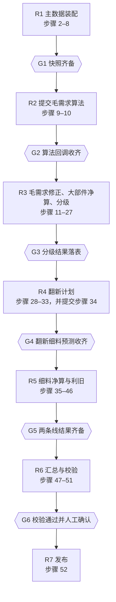

# PipelineGraph：流式计算框架设计

适用：Java 8、Spring Boot 2.6.15、Redis ≥ 6.2（Streams、`XAUTOCLAIM`）、MySQL 8、ClickHouse。

本文是设计稿，对应《售后预测计划净需求计算模型（参考版）》的 7 个阶段、52 个步骤。文中的 Java 接口、Lua 脚本、DDL 都是说明设计用的骨架，没有编译或联调过。

## 1. 先记住这八句话

1. 一次计算是一个**有界**的数据流：数据来自版本快照，量有限，跑完就结束。框架用流的方式传输和限速，但不做无界实时计算。
2. 一个 pipeline 由 puller、runner、pusher 三段组成。pipeline 之间用通道连接，分布式模式下通道是 Redis Stream。
3. **chunk 是唯一的工作单位**：puller 一次拉一个 chunk，runner 处理它，pusher 抛出结果，三件事一起提交。传输、确认、重试、断点、监控都以 chunk 为粒度。
4. **runner 不保留跨 chunk 的状态**。需要全量数据才能算的步骤，先落表，过一道闸门，再由下一个 run 重新拉取。
5. 闸门和落表把图切开，切出来的每一块能一口气跑完，这一块就是一个 run。`plan()` 的工作就是找出这些 run 并排好顺序。
6. master 只做推进和记账，不碰业务数据；slave 只做拉取、计算、抛出。master 没有内存状态，换一个 pod 接手可以从控制面完整恢复。
7. 背压靠"下游积压到高水位，上游的提交就被拒绝"实现，一跳一跳传回源头，最终让源 puller 停止读库。
8. 控制面四层：round、run、pipeline、chunk。一次提交的事实先原子地写进 Redis，再由 master 归并到 MySQL 或 Redis 的控制面存储。

## 2. 总体架构



Redis 是硬依赖，因为分布式通道、split 队列、提交事件都在 Redis Stream 上。MySQL 是可选依赖，只在控制面存储选 MySQL 时需要。

## 3. 核心概念

| 概念 | 含义 |
| --- | --- |
| PipelineGraph | 用户输入的数据流图：pipeline 是节点，流边、数据集依赖、闸门是边 |
| Pipeline | puller + runner + pusher |
| Channel | 一条流边的载体。每条边一个通道、一个消费组 |
| Dataset | 一张有名字的表（MySQL 或 ClickHouse）。pusher 写它，后面的 puller 读它 |
| Chunk | puller 一次拉到的一批数据，带 chunkId |
| Gate | 闸门：等一个条件成立再放行下游 |
| Run | 一组能一次跑到底的 pipeline，它们的准入条件相同 |
| ExecutionPlan | `plan()` 的产物：run 列表、闸门、阶段顺序、每个 run 的执行模式。不可变，带 hash |
| Round | ExecutionPlan 的一次执行，对应业务上的一个计划版本 |

四层标识的写法：

| 层 | 示例 | 生成方式 |
| --- | --- | --- |
| roundId | `net-demand-20261113-01` | 提交时生成；`(graph, bizKey)` 唯一，同一计划版本重复提交返回已有 round |
| runId | `R3` | `plan()` 按拓扑顺序编号 |
| pipelineId | `big-net` | 用户在图里起的名字，图内唯一 |
| chunkId | `S0012.0` | 源 chunk 是 split 编号 `S0012`；下游 chunk 是"上游 chunkId + 输出序号" |

chunkId 由血缘推出，所以同一个输入重放时，产出的 chunkId 不变。这一点是幂等写库的基础。

## 4. Pipeline 模型

### 4.1 三段各自的种类

| 段 | 种类 | 行为 |
| --- | --- | --- |
| Puller | `SplitPuller`（MySQL / ClickHouse） | master 把表切成 split 放进 split 队列，slave 领一个 split，按范围读库 |
| | `StreamPuller` | 用消费组读上游通道，一条 Stream 记录是一个 chunk |
| | `KafkaPuller` | round 开始时锁定每个分区的起止 offset，一段 offset 区间是一个 split |
| Runner | `RowRunner` | 逐行处理：映射、过滤、展开 |
| | `BatchRunner` | 整个 chunk 一起处理：批量查库、滚动净算、组装调用入参 |
| Pusher | `StreamPusher` | 把结果切成 chunk 写入下游通道 |
| | `TablePusher` | 幂等写 MySQL 或 ClickHouse |
| | `HttpPusher` | 调外部接口，批次号用 chunkId |
| | `Route` / `Tee` | 按条件分流到多个输出口；同一份结果写多个去向 |

非流式的库通过 `SplitPuller` + `StreamPusher` 流化：读出来的行攒成 chunk 写进 Redis Stream，下游用 `StreamPuller` 接着处理。

所有 puller 最终都是从一条 Redis Stream 领活：`StreamPuller` 领的是数据，`SplitPuller` 领的是 split 描述。因此确认、超时回收、多 pod 分摊、完成判定只需要实现一套。

### 4.2 接口骨架

```java
/** 一批数据，也是提交单位。 */
public final class Chunk<T> {
    private final String chunkId;
    private final List<T> rows;
    private final Map<String, String> headers;   // roundId、runId、pipelineId、输出口、行数
    // 构造与 getter 略
}

/** master 侧：把有界数据源切成 split，每个 split 是一个源 chunk。 */
public interface SplitEnumerator {
    List<Split> enumerate(EnumContext ctx);       // 结果必须确定：同一快照两次枚举得到同样的 split
}

/** slave 侧：拉一个 chunk；没有数据时返回 null。 */
public interface Puller<I> extends AutoCloseable {
    void open(PullContext ctx);
    Chunk<I> pull(long timeoutMs) throws InterruptedException;
}

public interface RowRunner<I, O> {
    void process(I row, Collector<O> out, RunContext ctx) throws Exception;
}

public interface BatchRunner<I, O> {
    void process(List<I> rows, Collector<O> out, RunContext ctx) throws Exception;
}

/** Collector 支持命名输出口，用于分叉。 */
public interface Collector<O> {
    void emit(O row);
    void emit(String port, O row);
}

public interface Pusher<O> extends AutoCloseable {
    void open(PushContext ctx);
    /** 写外部系统的 pusher 在这里完成幂等写；流通道的写入由框架在提交脚本里完成。 */
    void push(Chunk<O> chunk, PushContext ctx) throws Exception;
}
```

`RunContext` 提供三样东西：round 参数（计划版本、月桶）、`lookup(dataset, keys)` 批量查快照表、`sideInput(name)` 读小维表缓存。

### 4.3 slave 上的一轮循环

```text
loop:
    等本地额度            // 在处理中的 chunk 数低于上限才继续，上限见 7.1
    chunk = puller.pull()  // XREADGROUP，或用 XAUTOCLAIM 接手别人超时的 chunk
    outs  = runner.run(chunk)
    外部 pusher 写库       // 幂等，先于提交
    r = commit.lua(...)    // 原子：确认输入 + 写下游通道 + 写 journal
    r == BUSY     → 下游积压，保持 chunk 不放，退避后重试提交，期间续租
    r == CONFLICT → 这个 chunk 已被别人提交，丢弃本次结果
```

处理时间长的 chunk，slave 每 20 秒执行一次 `XCLAIM ... JUSTID` 续租；超过 60 秒没有续租的 chunk 会被其他 slave 接手。投递次数超过上限的 chunk 转入死信流，状态记为 `DEAD`。

### 4.4 chunk 对业务键封闭

净需求计算的粒度是料号 × 节点 × 月，逐月滚动（步骤 21）和全网平衡（步骤 22）都要求一个料号的全部节点、全部月份同时在场。框架的约定是：**一个替代组的所有行必须落在同一个 chunk 里**。

- 源头切 split 时按替代组的键范围或哈希桶切，chunk 边界对齐到键边界，不在一个组中间断开。
- runner 需要的其他数据（库存、在途、安全库存）用 `ctx.lookup()` 按本 chunk 的料号批量查快照表，不做流与流的 join。
- 逐 chunk 处理不会打散分组，所以封闭性沿着流一路保持。

跨料号的计算不满足封闭性，例如翻新产能是所有料号共用的（步骤 28）。这类步骤的做法见第 6 节的"物化边"。

"攒批"有两种写法，都不破坏上面的约定：源 pipeline 把一个 split 读出的行按行数或字节数切成多个 chunk；流 pipeline 把 `pullBatch` 设为 N，一次拉 N 个 chunk 合并处理、一起提交。

## 5. 输入数据流图与 Builder

图可以用 YAML 描述，也可以直接用 Java 构建。YAML 里的 `bean` 指向 Spring 容器中的 runner。

```yaml
graph: net-demand
pipelines:
  - id: gd-fix
    puller: { type: clickhouse, dataset: algo_gross_demand, splitBy: material_group, splits: 64 }
    runner: { type: batch, bean: grossDemandFixRunner }
    pusher: { type: route, ports: { big: stream, fine: stream } }
  - id: big-net
    puller: { type: stream }
    runner: { type: batch, bean: bigPartNetRunner }
    pusher:
      type: tee
      outputs:
        - { type: clickhouse, dataset: nd1_big }
        - { type: stream }
edges:
  - { from: gd-fix.big, to: big-net }
gates:
  - id: algo-callback
    type: external
    after: [gd-submit]
    before: [gd-fix]
    timeout: 2h
    onTimeout: OPEN_WITH_FALLBACK
```

```java
PipelineGraph graph = PipelineGraph.builder("net-demand")
    .pipeline("gd-fix", p -> p
        .pull(Pullers.clickhouse("algo_gross_demand").splitBy("material_group", 64))
        .run(Runners.batch(grossDemandFixRunner))
        .push(Pushers.route("big", "fine")))
    .pipeline("big-net", p -> p
        .pull(Pullers.stream())
        .run(Runners.batch(bigPartNetRunner))
        .push(Pushers.tee(Pushers.clickhouse("nd1_big"), Pushers.stream())))
    .edge("gd-fix.big", "big-net")
    .gate("algo-callback", Gates.external().timeout(Duration.ofHours(2)).onTimeout(OPEN_WITH_FALLBACK))
        .after("gd-submit").before("gd-fix")
    .build();                                  // 或 PipelineGraph.builder().from(yamlSpec).build()

ExecutionPlan plan = graph.plan(PlanOptions.defaults());
System.out.println(plan.explain());
RoundHandle round = engine.submit(plan, RoundParams.of("bizKey", "PLAN-2026-11"));
```

图里有三种边：

| 边 | 怎么声明 | 性质 |
| --- | --- | --- |
| 流边 | `edge(from, to)` | 上下游同时运行，数据边产边消 |
| 物化边 | 不用声明。puller 读的 dataset 正好是图里某个 pusher 写的 dataset，框架自动识别 | 上游写完，下游才能开始读 |
| 闸门边 | `gate(...).after(...).before(...)` | 条件成立，下游才能开始 |

## 6. plan()：把图切成 run

### 6.1 规划步骤

1. **校验**。图必须无环；每个流输出口有且只有一个下游；上下游行类型一致；每个 `SplitPuller` 的切分键存在。
2. **给边分类**。流边、物化边、闸门边。每条物化边自动生成一个"上游完成"闸门。
3. **求区域**。去掉物化边和闸门边，只看流边，求连通分量。一个连通分量叫一个区域，区域内的 pipeline 必须同时运行。
4. **合并成 run**。计算每个区域的入闸集合（做传递约简，只保留最靠近它的那些闸门）。入闸集合相同的区域合并为一个 run，因为它们会在同一时刻获得准入。
5. **死锁检查**。闸门的两端不能落在同一个 run 里。如果 A 到 B 既有流边、又有一道等 A 完成的闸门，B 不启动就不消费，A 被背压堵住永远完不成。遇到这种情况 `plan()` 报错，并提示把那条流边改成物化边。
6. **排阶段**。run 之间的依赖是一张无环图，按拓扑分层得到阶段，同一阶段的 run 可以并行。
7. **选执行模式**。按拓扑形状和数据量提示为每个 run 选模式（见 6.2），并确定每条通道的实现、每个 pipeline 的并行度和水位。
8. **冻结**。产出不可变的 `ExecutionPlan`，计算 hash，随 round 一起存进控制面。断点续传时比对 hash，图变了就拒绝续跑。

需求文档提到翻新量与细料需求之间有循环依赖，建议按固定轮数迭代。图本身不允许有环，固定轮数的迭代由 builder 展开成 N 段首尾相接的 run。

### 6.2 三种执行模式

| 模式 | 适用的 run | 通道 | 线程与 pod | 断点粒度 |
| --- | --- | --- | --- | --- |
| `INLINE` | 一条直链，数据量小 | 直接方法调用，没有队列 | 单 pod 单线程 | 源 chunk |
| `LOCAL` | 有分叉或合流，数据量中等 | JVM 内有界队列 | 单 pod，每个 pipeline 一个线程 | 整个 run 重跑，依赖 pusher 幂等 |
| `CLUSTER` | 数据量大，或用户指定并行度大于 1 | Redis Stream | 多 pod，每个 pipeline 按并行度起线程 | 每个 pipeline 的 chunk |

默认规则：用户给了 `mode` 就用用户的；否则预估行数低于阈值时，直链选 `INLINE`、其他选 `LOCAL`；预估行数高于阈值选 `CLUSTER`。`LOCAL` 的断点粒度粗，是因为内存队列里的数据会随进程一起丢失，所以只把它用在重跑成本低的 run 上。

### 6.3 explain 输出示例

```text
ExecutionPlan net-demand  hash=3f9a...  7 runs / 6 gates / 22 pipelines
Stage 1  R1  CLUSTER  mat-map, mat-attr, net-topo, bom, wo-clean, ib-load, param-load
         G1  barrier   R1 写出的全部快照 dataset
Stage 2  R2  INLINE   gd-submit
         G2  external  毛需求算法回调收齐，超时 2h 后走兜底
Stage 3  R3  CLUSTER  gd-fix → big-net → core-grade ; gd-fix → fine-gd-sink
         G3  barrier   dataset grade_result
...
```

## 7. 闸门

闸门是 run 之间的等待点，只由 master 判定，状态存在控制面，所以 master 切换或集群重启后不会丢。

| 类型 | 放行条件 | 用在哪里 |
| --- | --- | --- |
| `barrier` | 指定 dataset 的所有写入方 pipeline 都已成功 | 物化边自动生成 |
| `condition` | 用户提供的判定函数返回放行，master 定时轮询 | 校验通过、行数达到预期 |
| `external` | 外部系统回调 `POST /gates/{id}/signal`，且关联的批次号全部收齐 | 异步调用外部算法 |
| `manual` | 有人在管理接口上点了放行 | 发布前审批 |
| `timer` | 到达指定时间 | 等业务库日切 |

```java
public interface GateCondition {
    GateDecision evaluate(GateContext ctx);     // OPEN / WAIT / REJECT
}
```

外部信号先写进控制面再判定，判定是按当前状态算的，不是按事件触发的，所以信号早到、重复到、master 当时不在线都不影响结果。

每个闸门有超时策略：`FAIL`（round 失败）、`OPEN_WITH_FALLBACK`（放行并在上下文里打标，下游走兜底逻辑）、`ALERT_AND_WAIT`（告警后继续等）。

## 8. 多 pod 执行：master 与 slave

### 8.1 选主

所有 pod 启动后都尝试 `SET pg:leader <podId> NX PX 15000`，成功者成为 master，每 5 秒续期。当选时执行 `INCR pg:epoch` 取得一个只增不减的任期号，master 对控制面的每次写入都带任期号做条件更新，旧 master 恢复后写不进去。选主做成 `LeaderElector` 接口，控制面选 MySQL 时也可以换成 MySQL 租约行实现。

master 所在的 pod 默认同时承担 slave 的工作，可以用配置关掉。

### 8.2 master 的推进循环

master 每秒跑一遍下面的循环。每一步都是"读当前状态，条件更新"，重复执行没有副作用。

```text
for round in 运行中的 round:
    消费 journal，把 chunk 事件批量归并进控制面存储
    对每个 CLOSED 的闸门：上游条件满足 → OPEN
    对每个 PENDING 的 run：入闸全部 OPEN → 建通道和消费组、枚举 split、发布期望状态 → RUNNING
    对每个 RUNNING 的 pipeline：上游全部成功（或枚举完成）且输入流 XLEN = 0 → SUCCEEDED
    对每个 RUNNING 的 run：pipeline 全部成功且行数对账通过 → SUCCEEDED，清理通道
    采样背压指标，检查 slave 心跳
```

两个细节：

- **完成判定只看 XLEN**。提交脚本在确认输入的同时把它从流里删掉，所以输入流的长度就等于"未投递 + 处理中"的 chunk 数，长度为 0 且不会再有新数据进来，就是处理完了。不需要在流里塞结束标记。
- **行数对账**。每条流边上，上游提交事件里的输出行数之和必须等于下游提交事件里的输入行数之和。对不上时 run 置为失败并告警。

### 8.3 slave 与 puller 分压

master 把"哪些 pipeline 处于运行中、各自的并行度"写成期望状态。slave 每秒读一次，在本地增减 pipeline 线程，每个线程以 `<podId>#<序号>` 作为消费者名加入该 pipeline 的消费组。

分压不需要 master 分配：所有 pod 的线程在同一个消费组里竞争拉取，谁有空余额度谁拉。处理慢的 pod 自然拉得少。源 pipeline 的 split 队列也是同样的机制。

slave 每 5 秒上报心跳。某个 pod 挂掉后，它名下没提交的 chunk 超过 60 秒无人续租，被其他 slave 用 `XAUTOCLAIM` 接手。

## 9. 背压

puller 是主动拉取的，没拉走的数据留在 Redis 里，所以单看 puller 自身不会被撑爆。真正的风险有两处：slave 进程里同时持有的 chunk 太多；Redis 里的通道积压无限增长。背压分三层处理。

### 9.1 进程内：额度

每个 pipeline 线程同一时刻只持有 `pullBatch` 个输入 chunk，上一批提交之前不拉下一批。单 pod 的内存上限可以直接算出来：

```text
内存上限 ≈ Σ(各 pipeline 线程数 × pullBatch × maxChunkBytes × 反序列化膨胀系数)
```

`StreamPusher` 切 chunk 时同时受行数和字节数两个上限约束（默认 5000 行、1 MB），所以 `maxChunkBytes` 是有保证的。

### 9.2 通道：高低水位

每条通道有高水位和低水位（默认 64 和 32 个 chunk）。提交脚本在写下游之前先检查下游通道长度，达到高水位就整体拒绝，什么都不改：

```lua
-- commit.lua（骨架）
-- KEYS[1] 输入流  KEYS[2] journal  KEYS[3..] 输出流
-- ARGV[1] 消费组  ARGV[2] 输入记录 id  ARGV[3] 高水位  ARGV[4] 事件 JSON
-- ARGV[5..] 成对出现：输出流在 KEYS 中的下标、chunk 内容
for i = 3, #KEYS do
  if redis.call('XLEN', KEYS[i]) >= tonumber(ARGV[3]) then
    return -1                                   -- BUSY：下游积压
  end
end
if redis.call('XACK', KEYS[1], ARGV[1], ARGV[2]) == 0 then
  return 0                                      -- CONFLICT：已被其他 slave 提交
end
redis.call('XDEL', KEYS[1], ARGV[2])
for i = 5, #ARGV, 2 do
  redis.call('XADD', KEYS[tonumber(ARGV[i])], '*', 'c', ARGV[i + 1])
end
redis.call('XADD', KEYS[2], '*', 'e', ARGV[4])
return 1
```

收到 `BUSY` 的线程带着已算好的结果等待，等下游长度降到低水位以下再重试。它等待期间不拉新 chunk，于是它自己的输入通道开始积压，它的上游也会收到 `BUSY`。压力这样逐跳回传，直到源 puller 停止读库。

高水位是软上限：一个输入 chunk 展开出多个输出 chunk 时，单次提交可能超出一点，超出量不超过一次提交的输出数。

写库的 pusher 是同步调用，库慢了线程自然阻塞，效果相同。ClickHouse 的 pusher 另外限制最小批量，避免产生过多小分片。

### 9.3 全局：master 监测

master 每秒采样各通道的长度、流入流出速率、最老 chunk 的等待时间，以及各 pipeline 线程处于 `BUSY` 等待的时间占比。

| 检测到的情况 | 判断 | 动作 |
| --- | --- | --- |
| 某 pipeline 输入通道满、输出通道不满 | 它是瓶颈 | 在并行度上限内调高它的期望并行度，slave 自动加线程 |
| 某 pipeline 长时间处于 `BUSY` | 它被下游拖住 | 只记录指标，不处理，根因在瓶颈处 |
| Redis `used_memory` 超过阈值 | 全局风险 | 置全局限流标志，所有源 puller 暂停，告警 |
| 某 chunk 等待时间超过阈值 | 卡死或毒数据 | 告警，附 chunkId 和持有它的 pod |

## 10. 控制面

### 10.1 四层状态

| 层 | 状态 | 谁改 |
| --- | --- | --- |
| round | `CREATED → RUNNING → SUCCEEDED / FAILED / CANCELLED`，可 `PAUSED` | master |
| run | `PENDING → RUNNING → SUCCEEDED / FAILED`，可 `PAUSED` | master |
| pipeline | `PENDING → RUNNING → SUCCEEDED / FAILED` | master |
| chunk | `PENDING → RUNNING → DONE / DEAD` | slave 产生事件，master 归并 |
| gate | `CLOSED → OPEN / REJECTED / TIMEOUT` | master |

失败向上传播：chunk 进死信，所属 pipeline 失败，所属 run 失败，round 失败。与失败 run 无依赖关系的其他 run 会跑完，不会被中断。

### 10.2 提交事实与控制面存储的关系

chunk 的提交必须和"确认输入、写下游"是同一个原子操作，而 Redis 与 MySQL 之间做不到原子。所以分成两步：

1. slave 在 `commit.lua` 里把提交事件写进 `journal` 流。这一步和数据提交是原子的，是事实的唯一来源。
2. master 消费 `journal`，把事件批量、幂等地写进 `ControlPlaneStore`。存储里的 chunk 状态是 journal 的投影，会晚几百毫秒。

这样两种存储的实现都很薄，slave 不直接写 MySQL，MySQL 的写入量由 master 攒批控制。master 判定 pipeline 完成时，除了输入流为空，还要求 journal 已经消费到末尾。

```java
public interface ControlPlaneStore {
    void createRound(RoundRecord round, List<RunRecord> runs,
                     List<GateRecord> gates, List<PipelineRecord> pipelines);
    boolean casRoundStatus(String roundId, RoundStatus expect, RoundStatus target, long epoch);
    boolean casRunStatus(String roundId, String runId, RunStatus expect, RunStatus target, long epoch);
    boolean casPipelineStatus(String roundId, String pipelineId, PipelineStatus expect, PipelineStatus target, long epoch);
    boolean casGateStatus(String roundId, String gateId, GateStatus expect, GateStatus target, long epoch);
    void saveGateSignal(String roundId, String gateId, String signalKey, String payload);
    void applyChunkEvents(String roundId, List<ChunkEvent> events, long epoch);   // 批量、幂等
    RoundView loadRound(String roundId);                                          // 四层树，恢复和监控共用
    List<String> findActiveRounds();
    List<ChunkRecord> queryChunks(ChunkQuery query);
}
```

### 10.3 两种存储怎么选

| | MySQL | Redis |
| --- | --- | --- |
| 适合 | 生产环境 | 开发、测试、轻量部署 |
| 历史查询 | SQL 任意查，可长期保留 | 只能按 key 查，round 结束后按 TTL 过期 |
| 条件更新 | `UPDATE ... WHERE status = ? AND master_epoch <= ?` | Lua 脚本内比较后写入 |
| 额外依赖 | 多一个 MySQL | 无 |
| Redis 数据全丢时 | 还能知道哪些 run 已经成功，从未完成的 run 重跑 | 控制面一起丢，只能整轮重跑 |

### 10.4 MySQL 表结构

```sql
CREATE TABLE pg_round (
  round_id      VARCHAR(64)  NOT NULL PRIMARY KEY,
  graph_name    VARCHAR(64)  NOT NULL,
  biz_key       VARCHAR(128) NOT NULL,          -- 业务幂等键，如计划版本号
  plan_hash     CHAR(32)     NOT NULL,
  plan_json     MEDIUMTEXT   NOT NULL,          -- 冻结的 ExecutionPlan
  params_json   TEXT,
  status        VARCHAR(16)  NOT NULL,
  master_epoch  BIGINT       NOT NULL,
  created_at    DATETIME(3)  NOT NULL,
  started_at    DATETIME(3),
  finished_at   DATETIME(3),
  UNIQUE KEY uk_biz (graph_name, biz_key)
);

CREATE TABLE pg_run (
  round_id      VARCHAR(64) NOT NULL,
  run_id        VARCHAR(16) NOT NULL,
  stage         INT         NOT NULL,
  exec_mode     VARCHAR(12) NOT NULL,           -- INLINE / LOCAL / CLUSTER
  status        VARCHAR(16) NOT NULL,
  attempt       INT         NOT NULL DEFAULT 0,
  master_epoch  BIGINT      NOT NULL,
  started_at    DATETIME(3),
  finished_at   DATETIME(3),
  PRIMARY KEY (round_id, run_id)
);

CREATE TABLE pg_gate (
  round_id      VARCHAR(64) NOT NULL,
  gate_id       VARCHAR(64) NOT NULL,
  gate_type     VARCHAR(16) NOT NULL,
  before_run    VARCHAR(16) NOT NULL,
  status        VARCHAR(16) NOT NULL,
  deadline_at   DATETIME(3),
  opened_by     VARCHAR(64),                    -- master / 回调方 / 操作人
  opened_at     DATETIME(3),
  context_json  TEXT,                           -- 兜底标记、已收到的信号摘要
  master_epoch  BIGINT      NOT NULL,
  PRIMARY KEY (round_id, gate_id)
);

CREATE TABLE pg_gate_signal (
  round_id      VARCHAR(64)  NOT NULL,
  gate_id       VARCHAR(64)  NOT NULL,
  signal_key    VARCHAR(128) NOT NULL,          -- 如外部调用的批次号
  payload       TEXT,
  received_at   DATETIME(3)  NOT NULL,
  PRIMARY KEY (round_id, gate_id, signal_key)
);

CREATE TABLE pg_pipeline (
  round_id      VARCHAR(64) NOT NULL,
  pipeline_id   VARCHAR(64) NOT NULL,
  run_id        VARCHAR(16) NOT NULL,
  status        VARCHAR(16) NOT NULL,
  parallelism   INT         NOT NULL,
  enum_done     TINYINT     NOT NULL DEFAULT 0, -- 源 pipeline：split 是否已全部入队
  chunks_total  BIGINT      NOT NULL DEFAULT 0,
  chunks_done   BIGINT      NOT NULL DEFAULT 0,
  rows_in       BIGINT      NOT NULL DEFAULT 0,
  rows_out      BIGINT      NOT NULL DEFAULT 0,
  master_epoch  BIGINT      NOT NULL,
  started_at    DATETIME(3),
  finished_at   DATETIME(3),
  PRIMARY KEY (round_id, pipeline_id),
  KEY idx_run (round_id, run_id)
);

CREATE TABLE pg_chunk (
  round_id      VARCHAR(64)  NOT NULL,
  pipeline_id   VARCHAR(64)  NOT NULL,
  chunk_id      VARCHAR(128) NOT NULL,
  run_id        VARCHAR(16)  NOT NULL,
  status        VARCHAR(12)  NOT NULL,
  attempt       INT          NOT NULL DEFAULT 0,
  owner         VARCHAR(80),                    -- podId#线程序号
  split_spec    VARCHAR(1024),                  -- 仅源 chunk：键范围 / offset 区间
  rows_in       BIGINT,
  rows_out      BIGINT,
  cost_ms       INT,
  error         VARCHAR(2000),
  updated_at    DATETIME(3)  NOT NULL,
  PRIMARY KEY (round_id, pipeline_id, chunk_id),
  KEY idx_status (round_id, run_id, status)
);
```

`pg_chunk` 是写入量最大的表，一轮可能有几十万行。master 每 200 毫秒或每 500 条事件写一批，round 结束 N 天后按 `round_id` 清理。

### 10.5 Redis key 布局

所有 key 用 `{roundId}` 做哈希标签，保证一个 round 落在 Redis Cluster 的同一个槽上，`commit.lua` 才能跨多条流原子执行。代价是一个 round 的全部流量压在一个分片上，不同 round 可以分散到不同分片。

```text
pg:leader                              STRING  当前 master 的 podId
pg:epoch                               STRING  任期号
pg:workers                             ZSET    podId → 最近心跳时间
pg:rounds:active                       SET     运行中的 roundId
pg:{<roundId>}:desired                 HASH    pipelineId → 期望并行度（master 写，slave 读）
pg:{<roundId>}:ch:<edgeId>             STREAM  数据通道
pg:{<roundId>}:split:<pipelineId>      STREAM  源 pipeline 的 split 队列
pg:{<roundId>}:splitidx:<pipelineId>   SET     已入队的 splitId，保证枚举幂等
pg:{<roundId>}:dlq:<pipelineId>        STREAM  死信
pg:{<roundId>}:journal                 STREAM  chunk 提交事件

# 以下仅在控制面存储选 Redis 时使用
pg:{<roundId>}:round                   HASH
pg:{<roundId>}:run:<runId>             HASH
pg:{<roundId>}:gate:<gateId>           HASH
pg:{<roundId>}:pl:<pipelineId>         HASH
pg:{<roundId>}:chunk:<pipelineId>      HASH    chunkId → 状态 JSON
```

## 11. 断点续传与一致性

### 11.1 保证的语义

- **流到流**：恰好一次。确认输入和写出结果在同一个 Lua 脚本里，要么都发生，要么都不发生。两个 slave 同时处理同一个 chunk 时，`XACK` 的返回值保证只有一个提交成功。
- **流到外部库**：至少一次投递，加上幂等写入，结果等同于恰好一次。写库发生在提交之前，提交前崩溃会重放这个 chunk，再写一次同样的数据。

幂等写入的做法：

| 目标 | 做法 |
| --- | --- |
| MySQL | `INSERT ... ON DUPLICATE KEY UPDATE`，唯一键为"计划版本 + 业务键" |
| ClickHouse | `ReplacingMergeTree` 按"计划版本 + 业务键"去重；或写入 round 专属的临时分区，run 成功时 `REPLACE PARTITION` 一次性换入 |
| 外部接口 | 批次号用 chunkId，要求对方按批次号幂等 |

幂等成立的前提是 runner 对同一个输入 chunk 产出同样的结果。runner 读的是锁定版本的快照，这一点由需求文档里"每个阶段落快照、后一阶段只读快照"保证。

### 11.2 各种故障怎么恢复

| 故障 | 恢复方式 | 重做范围 |
| --- | --- | --- |
| slave 线程异常 | chunk 留在待确认列表，超时后重新投递 | 一个 chunk |
| slave pod 挂掉 | 其他 slave 用 `XAUTOCLAIM` 接手 | 该 pod 未提交的 chunk |
| 毒数据反复失败 | 超过重试上限进死信，run 失败；修复后调用 `retry(runId)` 把死信放回通道 | 死信里的 chunk |
| master 挂掉 | 新 master 当选，从控制面加载运行中的 round，从 journal 的消费位点继续归并 | 无。slave 在此期间照常处理 |
| master 在枚举 split 中途挂掉 | 新 master 重新枚举，已入队的 splitId 被跳过 | 无 |
| 集群整体重启 | 通道和 journal 靠 Redis 持久化保留，控制面在存储里，启动后继续 | 未提交的 chunk |
| Redis 主从切换，丢失约 1 秒写入 | 通道和 journal 一起回退到同一个时间点，被回退的 chunk 重新处理；收尾时行数对账兜底 | 最后约 1 秒提交的 chunk |
| Redis 数据全丢（控制面在 MySQL） | 已成功的 run 不动；运行中的 run 整体重置，从它的源快照表重跑 | 未完成的 run |
| `INLINE` / `LOCAL` 的 run 所在 pod 挂掉 | master 把 run 派给另一个 pod | 见 6.2 的断点粒度 |

run 的边界都是落了表的 dataset，所以 run 是最后的重放单位：只要上游快照表还在，任何一个 run 都可以单独重跑。

### 11.3 人工操作

| 操作 | 效果 |
| --- | --- |
| `pause(roundId)` / `resume(roundId)` | 暂停后 slave 做完手上的 chunk 就停止拉取；恢复后从通道里剩下的继续 |
| `retry(runId)` | 失败的 run 把死信放回通道，继续跑 |
| `rerunFrom(runId)` | 重置该 run 及所有下游 run，清理它们的通道，从该 run 的源头重跑 |
| `skipChunk(chunkId)` | 把死信里的 chunk 标记为跳过，run 可以继续，round 结果打上"不完整"标记 |
| `openGate(gateId)` | 人工放行 |

## 12. 监控

指标通过 Micrometer 暴露，标签为 `graph`、`round`、`run`、`pipeline`。

| 层 | 指标 |
| --- | --- |
| 集群 | 存活 slave 数、master 任期号与切换次数、Redis 内存、运行中 round 数 |
| round | 当前阶段、已完成 run 数、各闸门等待时长、总耗时 |
| run | 状态、耗时、失败次数 |
| pipeline | 输入输出行速率、chunk 处理耗时分位数、输入通道长度、`BUSY` 等待时间占比、重投次数、死信数、当前并行度 |
| chunk | 最老未提交 chunk 的等待时间、重试次数分布 |

源 pipeline 的进度是"已完成 chunk 数 / split 总数"。流 pipeline 在上游完成之前不知道总量，显示已完成数和当前积压。

管理接口：

```text
GET  /pg/rounds/{roundId}                 四层树：run、闸门、pipeline、chunk 汇总
GET  /pg/rounds/{roundId}/chunks?status=  chunk 明细
GET  /pg/rounds/{roundId}/backpressure    各通道长度与瓶颈 pipeline
POST /pg/rounds/{roundId}/pause | resume | cancel
POST /pg/runs/{roundId}/{runId}/retry | rerun
POST /pg/gates/{roundId}/{gateId}/signal | open
```

建议的告警：闸门等待超时、出现死信、某 pipeline `BUSY` 占比持续高于 80%、最老 chunk 等待超过阈值、master 切换、Redis 内存超过阈值、行数对账失败。

## 13. 套到净需求计算模型上

按第 6 节的规则，52 个步骤切成 7 个 run、6 道闸门。



| run | pipeline | 模式 | 为什么在这里切开 |
| --- | --- | --- | --- |
| R1 | 7 条互相独立的"读业务库 → 清洗 → 写快照"，对应步骤 2–8 | `CLUSTER` | 后面所有 run 都只读这些快照，自动生成 `barrier` |
| R2 | `gd-submit`：读步骤 6、7 的底表，组装入参，调用毛需求算法 | `INLINE` | 算法是异步的，要等回调，`external` 闸门，超时走兜底预测并打标 |
| R3 | `gd-fix`（步骤 11–14）分流到 `big-net`（16–24）和 `fine-gd-sink`（15）；`big-net` 接 `core-grade`（25–27） | `CLUSTER` | 步骤 28 的产能是全体料号共用的，不能逐 chunk 算，分级结果必须先落表 |
| R4 | `cap-alloc`（28–29）按翻新点切 split，按月份和优先级顺序读；接 `refurb-out`（30–32）和 `refurb-req`（33，并提交 34） | `LOCAL` | 再次等待外部回调 |
| R5 | `fine-merge`（35–40）接 `harvest`（41–46） | `CLUSTER` | 汇总需要两条线的最终结果都落表 |
| R6 | `sum-round`（47–48）、`conserve`（49）、`diff`（50）、`trace`（51）四条并行 | `LOCAL` | 发布前要校验通过，`condition` 加 `manual` |
| R7 | `publish`（52） | `INLINE` | 终点 |

步骤 1"创建计划版本"不是 pipeline，它就是创建 round：计划版本号作为 `bizKey`，数据截止时间和 16 个月的月桶作为 round 参数。

几个步骤的落法值得单独说明：

- **步骤 21–22，滚动净算与全网平衡**。只涉及单个替代组的所有节点和月份，满足 chunk 封闭，在 `big-net` 的 `BatchRunner` 里一次算完。库存、在途、安全库存用 `ctx.lookup()` 按本 chunk 的料号批量查。
- **步骤 28，产能约束**。产能在料号之间按优先级分配，是全局约束。R3 把分级结果落表，R4 的 `cap-alloc` 以翻新点为 split，每个 split 内按月份和优先级有序读出、顺序扣减产能。一个翻新点的数据在一个 split 里，所以这里的 chunk 对"翻新点"封闭。
- **步骤 42，拆解 BOM 展开**。报废件按大部件料号组织，利旧量按细料料号组织，键变了。不做流内重分区：报废件量在 R4 已经落表，R5 的 `harvest` 以细料料号为驱动，用 `lookup` 让 ClickHouse 按细料聚合"报废件 × 拆解 BOM"。
- **步骤 10、34，外部调用**。提交和收结果分在闸门两侧。`HttpPusher` 用 chunkId 当批次号，重放不会重复计费或重复计算；闸门按批次号清点回调，收齐才放行。
- **两条线的两处衔接**（翻新计划量、报废件量）都经过落表的 dataset，不是流边，所以大部件线和细料线之间没有同时运行的耦合。

## 14. 模块划分与落地顺序

```text
pipelinegraph-api             Chunk、Puller、Runner、Pusher、GateCondition、SplitEnumerator
pipelinegraph-core            PipelineGraph、Builder、YAML 解析、Planner、ExecutionPlan
pipelinegraph-runtime         Master（调度、闸门、枚举、归并、背压监测）、Slave（pipeline 线程、续租、回收）
pipelinegraph-channel-redis   Redis Stream 通道、Lua 脚本
pipelinegraph-store-mysql     ControlPlaneStore 的 MySQL 实现
pipelinegraph-store-redis     ControlPlaneStore 的 Redis 实现
pipelinegraph-connectors      MySQL、ClickHouse、Kafka、HTTP 的 puller 与 pusher
pipelinegraph-admin           管理接口、指标
pipelinegraph-spring-boot-starter
```

| 里程碑 | 内容 | 验收 |
| --- | --- | --- |
| M1 | api、core、`INLINE` 与 `LOCAL` 模式、Redis 控制面 | 单进程跑通 R1–R3 的样例图，`plan().explain()` 输出符合预期 |
| M2 | Redis Stream 通道、`commit.lua`、master 与 slave、背压 | 多 pod 跑 `CLUSTER`；随机杀 slave，结果与不杀时逐行一致 |
| M3 | 五种闸门、MySQL 控制面、人工操作 | 杀 master、重启集群、清空 Redis 三种演练都能续跑 |
| M4 | 监控指标、管理接口、告警 | 压测时能从指标直接定位瓶颈 pipeline |

## 15. 我做的假设

以下几条是设计时默认的选择，与实际情况不符时对应章节需要调整。

- 技术栈沿用现有工程的 Java 8 和 Spring Boot 2.6.15。
- Redis 版本不低于 6.2。使用 Redis Cluster 时接受"一个 round 落在一个分片"。
- 单个 chunk 序列化后不超过约 1 MB，直接放在 Stream 记录里。如果有更大的行，需要把内容放到外部存储，Stream 里只放引用，本文没有展开。
- 一轮计算的 chunk 数量在百万以内，`pg_chunk` 用单表可以承受。
- 所有落库的结果表都能按"计划版本 + 业务键"做幂等写。
- 外部算法服务支持按批次号幂等，并能回调或被轮询。
- 第 13 节的 run 划分基于参考版模型的步骤描述，各 pipeline 的数据量和模式选择是估计的，要用真实数据量校准。
