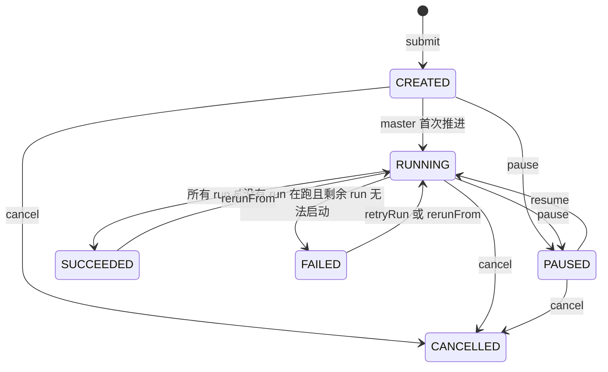
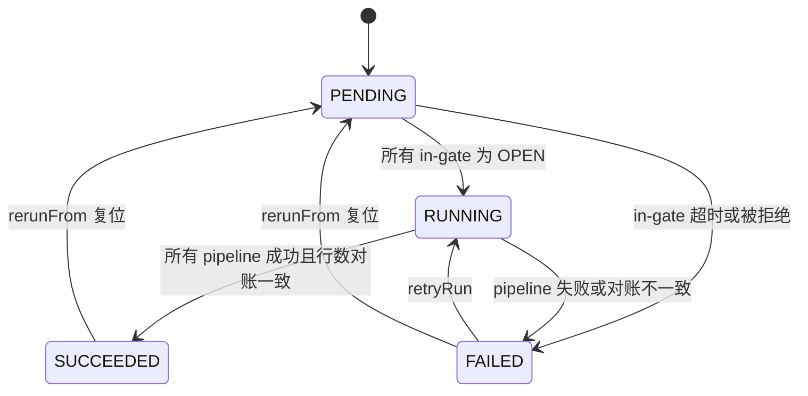
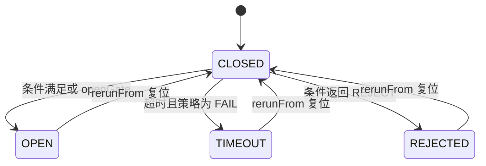

# 使用指南

本页讲怎么用 pipeliner 描述一次计算：核心概念、用 Java 或 YAML 定义图、JDBC 数据源和 sink、runner 的写法和生命周期、闸门、执行模式、chunk 与并行度、外部回调，以及标识符的规则和限制。读者是要在业务里定义 pipeline 图的开发者；第一次接触请先看[快速开始](./getting-started.md)。部署、调优和运维见[运维手册](./operations.md)和[配置参考](./configuration.md)。

- [核心概念](#核心概念)
- [定义一个图](#定义一个图)
  - [Java builder](#java-builder)
  - [YAML](#yaml)
- [数据源与 sink（JDBC）](#数据源与-sinkjdbc)
  - [Source 与分片策略](#source-与分片策略)
  - [Sink 与版本化写入](#sink-与版本化写入)
- [Runner](#runner)
  - [Row 与 Batch，类型形式与实例形式](#row-与-batch类型形式与实例形式)
  - [Lifecycle 与 ComponentFactory](#lifecycle-与-componentfactory)
  - [读取其他 dataset：ReadsDatasets](#读取其他-datasetreadsdatasets)
  - [在 runner 里查询：RunContext.lookup](#在-runner-里查询runcontextlookup)
  - [行值类型](#行值类型)
- [闸门](#闸门)
- [执行模式与规划](#执行模式与规划)
- [chunk 与并行度](#chunk-与并行度)
  - [chunkKey 与 chunkRows](#chunkkey-与-chunkrows)
  - [并行度与自动扩容](#并行度与自动扩容)
- [外部回调与批次号](#外部回调与批次号)
- [标识符规则与限制](#标识符规则与限制)
- [使用方必须遵守的约束](#使用方必须遵守的约束)

## 核心概念

pipeliner 把一次有界的批量计算描述成一张 **pipeline 图**，提交一次叫一个 **round**。

| 概念 | 含义 |
|---|---|
| **pipeline** | 由三段组成：**source**（puller，对应 `SplitSource`，读库；或者来自上游的 stream 边）、**runner**（`RowRunner` 逐行或 `BatchRunner` 逐批处理，可以没有，没有则原样透传）、**sink**（pusher，对应 `Sink`，落表；或者输出到下游 stream 边）。 |
| **port（输出口）** | runner 通过 `Collector.emit(port, row)` 把行发往某个输出口，默认口名是 `out`。一个输出口可以挂多个 sink（同一份输出写到多处），但最多只能连一条 stream 边。 |
| **edge（边）** | `PipelineGraph.Builder.edge(from, to)`：把一个 pipeline 的输出口接到另一个 pipeline 的输入，二者在**同一个 run 内**用通道连接（CLUSTER 是 Redis Stream，LOCAL 是内存队列，INLINE 是直接方法调用）。`from` 写 `pipeline` 或 `pipeline.port`。有 source 的 pipeline 不能有入边，没有 source 的 pipeline 必须有入边。 |
| **dataset** | source 和 sink 的 `datasetName()` 返回的名字，标记「这一步读 / 写的是哪份落了表的数据」。JDBC 的 source 和 sink 默认用表名，也可以用 `.dataset(...)` 指定。规划器据此发现 pipeline 之间的**物化依赖**。 |
| **gate（闸门）** | 控制 run 之间先后关系的开关：barrier、condition、external、manual、timer。闸门和落表把图切成多个 run。 |
| **run** | 图被闸门和落表切出来的、可以一口气跑完的一块：由 stream 边连通的 pipeline 组成。run 是重试和重放的单位，名字是 `R1`、`R2`……，按依赖深度（stage）排序。 |
| **round** | 一次提交。`(graph, bizKey)` 唯一：重复提交同一个 `bizKey` 返回已有的 `roundId`。round id 的格式是 `<图名>-<yyyyMMdd-HHmmss>-<12 位随机十六进制>`。 |
| **chunk** | 唯一的工作单位：传输、确认、重试、断点都以 chunk 为粒度。runner 不保留跨 chunk 的状态。源 pipeline 的 chunk 就是一个 split，id 是 `S0000`、`S0001`……；下游 chunk 的 id 由上游 chunk id 推出（`<父 id>><边序号>.<序号>`）；写 sink 的 chunk id 是 `<输入 chunk id>#<输出口>`。chunk id 是确定的，重放时不变。 |

层级关系：**round > run > pipeline > chunk**。

### 状态机

round、run 和 gate 的状态如下（`PipelineStatus` 与 run 的状态相同：`PENDING`、`RUNNING`、`SUCCEEDED`、`FAILED`；chunk 的状态是 `PENDING`、`DONE`、`DEAD`、`SKIPPED`）。







几点说明：

- 闸门只有在它的 `after` 一侧的 run 全部 `SUCCEEDED` 之后才会被「布防」（记录 `armedAt`），之后才开始判断条件和计算超时。
- 一个 run 在它所有的 in-gate（它的 pipeline 作为 `before` 的闸门）都是 `OPEN` 时启动。
- 一个 run 失败不会立即让 round 失败：只有当没有 run 在运行、且剩下的 `PENDING` run 都不可能再启动（依赖了失败的 run，或闸门 `TIMEOUT` / `REJECTED`）时，round 才变成 `FAILED`。`FAILED` 的 round 可以用 `retryRun` / `rerunFrom` 恢复，`CANCELLED` 不行。
- run 的 `attempt` 从 0 开始，每次 `rerunFrom` 加 1；操作规则见[运维手册](./operations.md#管理操作规则)。

## 定义一个图

### Java builder

```java
PipelineGraph g = PipelineGraph.builder("demo")
    .pipeline("load", p -> p
        .source(JdbcSources.mysql("mysql").table("src").columns("id", "k")
                .hashSplit("id", 8).orderBy("id").build())
        .batch(new MyBatchRunner()).ports("out")
        .sink(JdbcSinks.mysql("mysql").table("mid").upsertKeys("id")
                .versionColumn("pg_version")             // 版本化写入，见「Sink 与版本化写入」
                .dataset("mid").build())
        .mode(ExecMode.CLUSTER).chunkKey("id").chunkRows(800))
    .pipeline("post", p -> p
        .row(new MyRowRunner())
        .sink(JdbcSinks.clickhouse("ch").table("db.res").dataset("res").build()))
    .edge("load", "post")                        // stream 边：load 的输出口直接喂给 post
    .gate("approve", Gates.manual(),             // 闸门：after 全部成功后才放行 before
          g -> g.after("post").before("publish"))
    .pipeline("publish", p -> p
        .source(JdbcSources.clickhouse("ch").table("db.res").dataset("res").useFinal()
                .noSplit().build())                  // table 与 query 二选一；useFinal 只用于 ClickHouse 的 table 模式
        .batch(new PublishRunner())
        .sink(JdbcSinks.mysql("mysql").table("publish_log").upsertKeys("id").build()))
    .build();
```

`PipelineBuilder`（`.pipeline(id, p -> ...)` 里的 `p`）的方法：

| 方法 | 含义 |
|---|---|
| `source(SplitSource)` | 设置 source。JDBC 用 `JdbcSources.mysql(...)` / `clickhouse(...)` 构建。 |
| `row(RowRunner)` / `batch(BatchRunner)` | **实例形式**的 runner。 |
| `row(Class)` / `batch(Class)` | **类型形式**的 runner（推荐）。 |
| `runnerPerThread()` | 每个 worker 线程各自持有一个 runner，只能和类型形式一起用。 |
| `ports(String...)` | 声明输出口（`out` 总是存在）。 |
| `sink(Sink)` / `sink(port, Sink)` | 给输出口挂 sink；对同一个口多次调用，输出会同时写到多个 sink；`sink(port, ...)` 会自动声明这个口。 |
| `parallelism(int)` | 并行度，必须 ≥ 1。 |
| `mode(ExecMode)` | 执行模式提示。 |
| `estimatedRows(long)` | 估算行数，供规划器选择执行模式。 |
| `chunkRows(int)` / `chunkBytes(int)` / `chunkKey(String...)` | 输出 chunk 的切分，见[chunk 与并行度](#chunk-与并行度)。默认 `chunkRows` 为 5000，`chunkBytes` 为 1 MiB。 |

闸门通过 `.gate(id, Gates.xxx(), g -> g.after(...).before(...).timeout(duration, policy))` 声明，详见[闸门](#闸门)。

**物化边与自动 barrier**：规划器比较各 pipeline 的 source 和 sink 的 `datasetName()`。某个 pipeline 读的 dataset 恰好被另一个 pipeline 写入时，二者之间是**物化边**，规划器自动生成 id 为 `barrier:<dataset>` 的 barrier 闸门并据此切 run；stream 边（`.edge`）则在同一个 run 内用通道连接。上例中 `publish` 读 `res`、`post` 写 `res`，所以二者之间有自动 barrier，不必手写。如果一个 pipeline 自己也写这个 dataset，它不会等待自己的 barrier。

**何时要显式 barrier**：依赖不通过 dataset 名体现时（例如 runner 里按键 lookup 另一张表的结果），规划器看不到这条依赖，需要用 `Gates.barrier()` 的 `after(...)` / `before(...)` 手动声明。示例应用里的 `refurb-ready` 就是这种用法：`big-final` 和 `fine-net` 在运行时 lookup `cap-alloc` 的输出表。也可以让 source 或 runner 实现 `ReadsDatasets` 来声明这类依赖，见[读取其他 dataset](#读取其他-datasetreadsdatasets)。

规划器会在构图（`PipelineGraph.build()`）和注册（`registerGraph`，即应用启动）时做校验，规则见[标识符规则与限制](#标识符规则与限制)。

### YAML

`GraphYaml.load(InputStream, ComponentResolver)` 从 YAML 构建同样的图。YAML 里的 source、runner、sink 和条件通过 `ComponentResolver.resolve(name)` 按 **bean 名**引用（类型形式的 runner 用 `class:` 写类名）。

```yaml
graph: demo
pipelines:
  - id: load
    source: srcBean
    runner: { type: batch, bean: myBatchRunner }
    ports: [out]
    sinks: { out: [midSink] }
    mode: cluster
    chunkKey: [id]
    chunkRows: 800
  - id: post
    runner: { type: row, class: com.x.MyRowRunner, perThread: true }
    sinks: { out: [resSink] }
  - id: publish
    source: resSource
    runner: { type: batch, bean: publishRunner }
    sinks: { out: [logSink] }
edges:
  - { from: load, to: post }          # 具名端口写 load.big
gates:
  - id: approve
    type: manual                      # barrier | manual | condition | external | timer
    after: [post]
    before: [publish]
    timeout: 2h                       # 可选
    onTimeout: fail                   # fail | open_with_fallback | alert_and_wait
```

字段说明：

| 位置 | 字段 | 含义 |
|---|---|---|
| 顶层 | `graph`（或 `name`） | 图名 |
| `pipelines[]` | `id` | pipeline id |
| | `source` | source 的 bean 名 |
| | `runner.type` | `row` 或 `batch` |
| | `runner.bean` / `runner.class` | 实例形式（bean 名）或类型形式（类名，需要在当前类加载器里能找到） |
| | `runner.perThread`（或 pipeline 级的 `perThread`） | `true` 时每个线程一个 runner，只能和 `class:` 一起用，和 `bean:` 一起用会报错 |
| | `ports` | 输出口列表 |
| | `sinks` | `{口名: [sink bean 名...]}` |
| | `parallelism`、`mode`、`estimatedRows`、`chunkRows`、`chunkBytes`、`chunkKey` | 同 Java builder；`mode` 取 `inline` / `local` / `cluster`（不区分大小写） |
| `edges[]` | `from`、`to` | 同 Java 的 `edge` |
| `gates[]` | `id`、`type`、`after`、`before` | `type` 取 `barrier` / `manual` / `condition` / `external` / `timer` |
| | `timeout`、`onTimeout` | 超时和策略，`onTimeout` 取 `fail`（默认）/ `open_with_fallback` / `alert_and_wait` |
| | `condition` | `condition` 闸门必填（bean 名）；`external` 闸门也可以用它 |
| | `expectFrom` / `expectCount` | `external` 闸门：`expectFrom: <pipelineId>` 等价于 `Gates.externalCountOf`，`expectCount: n` 等价于 `Gates.externalCount(n)`；三者都有时优先级为 `expectFrom` > `condition` > `expectCount` |
| | `at` / `delay` | `timer` 闸门：`at` 为 epoch 毫秒，`delay` 是时长 |

**时长**（`timeout`、`delay`）写成带单位的字符串：支持 `ms`、`s`、`m`、`h`、`d`，可以连写（`1h30m`）；纯数字表示毫秒。`1:30:00` 这类时钟写法会被拒绝，不会被当作 60 进制整数。

## 数据源与 sink（JDBC）

`pipeliner-connectors` 提供 MySQL 和 ClickHouse 的 source 与 sink：`JdbcSources.mysql(ds)` / `JdbcSources.clickhouse(ds)` 和 `JdbcSinks.mysql(ds)` / `JdbcSinks.clickhouse(ds)`，`ds` 是 `pipeliner.datasources.<name>` 里的数据源名（见[配置参考](./configuration.md#基础配置)）。

### Source 与分片策略

`SplitSource` 的约定：master 调用 `enumerate()` 把数据切成若干 **split**，worker 调用 `read(split)` 读取每个 split。`enumerate()` 必须对同一份快照给出确定的结果（框架按顺序给 split 编号 `S0000`、`S0001`……）。

JDBC source 的构建选项：

| 方法 | 含义 |
|---|---|
| `table(t)` / `query(q)` | **二选一**，必须且只能设置一个。`query` 会被包成子查询 `(q) t` 读取。 |
| `columns(c...)` | 读取的列，默认 `*`。不能和 `query` 一起用。 |
| `where(w)` | 附加条件（不带 `WHERE` 关键字）。可以用 `:name` 引用 round 的参数（`engine.submit` 的 `params`）。不能和 `query` 一起用。 |
| `useFinal()` | 给表加 `FINAL`，只能用于 ClickHouse 的 `table` 模式。 |
| `orderBy(o)` | 每个 split 内部的排序。必须是**全序**，见下。 |
| `dataset(d)` | dataset 名，默认是表名；`query` 模式下默认没有 dataset。 |
| `hashSplit(col, n)` / `distinctSplit(col)` / `noSplit()` | 分片策略，默认 `noSplit()`。 |

构建时的校验（失败抛 `IllegalArgumentException`）：数据源名必填；`table` 和 `query` 恰好设置一个；`query` 不能和 `columns` / `where` / `useFinal` 同时使用；`useFinal` 只用于 ClickHouse；`hashSplit` 的列非空且 `n ≥ 1`；`distinctSplit` 的列非空。

**分片策略**：

| 策略 | 做法 |
|---|---|
| `noSplit()` | 一个 split，读整张表（或整个查询）。 |
| `hashSplit(col, n)` | 固定 `n` 个 split，第 `i` 个读 `col` 的哈希对 `n` 取模等于 `i` 的行：MySQL 用 `MOD(CRC32(col), n) = i`，ClickHouse 用 `cityHash64(col) % n = i`。**NULL 的哈希是 NULL，不属于任何桶，所以第 0 个桶额外包含 `col IS NULL` 的行**，NULL 不会丢。有的桶可能是空的。 |
| `distinctSplit(col)` | 先由 master 执行 `SELECT DISTINCT col ... ORDER BY col`，每个不同的值一个 split，split 内读 `col = <值>`。**NULL 值单独成一个 split**（读 `col IS NULL`）。值带类型保存并以对应的 JDBC 类型绑定：布尔、整数、小数、`double`、`Timestamp`（以 UTC 时刻保存，与 JVM 时区无关）、`LocalDateTime`、日期、时间、字节数组（Base64）、字符串。`double` 的 `NaN` / `Infinity` 不能用等值选择，遇到会抛错，请改用 `hashSplit`。 |

> [!WARNING]
> 使用 `hashSplit` 或 `distinctSplit` 却没有 `orderBy` 时，框架对每个数据集打一次 WARN：同一个 split 重放时必须读出**同样顺序**的行，否则 chunk 的切分会随执行次数而变，重试、重放的幂等就不成立。`orderBy` 请写成能唯一确定顺序的列组合，例如 `"material_id, node, month"`。

### Sink 与版本化写入

`Sink` 的约定：`write(Chunk, SinkContext)` **必须对同一个 chunk 幂等**，因为失败重试、autoclaim 重投、rerun 都会对同一个 chunk 重新调用；chunk id 在重放时保持不变。输出为空的 chunk 不会调用 sink。

JDBC sink 的构建选项：

| 方法 | 含义 |
|---|---|
| `table(t)` | 目标表，必填，原样拼进 SQL（可以带库名，如 `db.res`）。 |
| `upsertKeys(k...)` | MySQL 的业务唯一键列。不设置时，冲突行会更新全部列。**ClickHouse 不支持**，设置了会抛错（请用 `ReplacingMergeTree` 表）。键名不区分大小写。 |
| `versionColumn(c)` | 版本化写入，见下。 |
| `batchSize(n)` | 一次 `executeBatch` 的行数，默认 1000，必须 ≥ 1。 |
| `dataset(d)` | dataset 名，默认是表名。 |

写入方式：MySQL 在一个事务里执行 `INSERT ... ON DUPLICATE KEY UPDATE`，失败整体回滚；ClickHouse 是批量 `INSERT`。列取这个 chunk 全部行的列的并集；值只有 `null`、布尔、数值、字符串直接绑定，其他类型按 `toString()` 绑定。

**版本化写入**是 pipeliner 保证「重试、重跑、僵尸进程的旧写入不会覆盖新结果」的方式。每个 round 提交时得到一个全局单调递增的序号 `seq`，每次写入带版本 `writeVersion = seq × 1000 + attempt`（`attempt` 是所在 run 的 attempt），`SinkContext.writeVersion()` 和 `RunContext.writeVersion()` 都能取到它。`versionColumn("pg_version")` 让 sink 在每一行写入这个版本：

- **MySQL**：upsert 变成条件更新，只有新版本大于等于已存版本时才覆盖（形如 `c = IF(VALUES(ver) >= COALESCE(ver, 0), VALUES(c), c)`，版本列最后赋值）。
- **ClickHouse**：把表声明为 `ReplacingMergeTree(pg_version)`，排序键为业务键；读取这张表时必须带 `FINAL`（source 上用 `useFinal()`）才会只看到最高版本。

版本列必须是 `BIGINT`（ClickHouse 是 `UInt64`）。校验和之类的比较只应覆盖业务列，不含版本列。

> [!NOTE]
> run 的 attempt 必须小于 1000，否则版本会撞到下一个 round 的区间。达到 1000 的 run 不会再执行，请取消 round 并重新提交。

## Runner

### Row 与 Batch，类型形式与实例形式

| 接口 | 方法 | 说明 |
|---|---|---|
| `RowRunner` | `process(Row row, Collector out, RunContext ctx)` | 对 chunk 里的每一行依次调用一次 |
| `BatchRunner` | `process(List<Row> rows, Collector out, RunContext ctx)` | 对整个 chunk 调用一次，适合需要整批排序、聚合或批量 lookup 的逻辑 |

`out.emit(row)` 发往 `out` 口，`out.emit("big", row)` 发往指定口；发往没有声明的口会抛 `PipelinerException`。一个 pipeline 只能有一个 runner，不设置 runner 时行原样透传到 `out`。

runner 有两种声明方式：

- **实例形式**：`.row(new MyRowRunner())` / `.batch(new MyBatchRunner())`。图构建时就创建，是所有 round、所有线程共享的单例，必须线程安全。
- **类型形式（推荐）**：`.row(MyRowRunner.class)` / `.batch(MyBatchRunner.class)`；YAML 为 `runner: {type: batch, class: com.x.MyRunner}`。runner 对象在 pod 上第一个处理该 pipeline 的线程启动时，才通过 `ComponentFactory` 创建，pipeline 在该 pod 上结束后释放。加 `.runnerPerThread()`（YAML：`perThread: true`）则每个 worker 线程各自持有一个 runner，runner 不必线程安全。`perThread` 只能和类型形式一起用。

```java
.pipeline("grade", p -> p.row(CoreGradeRunner.class).runnerPerThread().sink(...))
```

> [!TIP]
> 有状态的 runner 请用类型形式：每个 pipeline 实例各有自己的对象。实例形式是共享单例，它的 `open()` / `close()` 按 pod 引用计数（见下）。

### Lifecycle 与 ComponentFactory

runner、source、sink 都可以选择实现 `Lifecycle`：

- `open(PipelineContext)`：pipeline 在本 pod 上被激活时、第一个 chunk 之前调用。`PipelineContext` 提供 `roundId()`、`runId()`、`pipelineId()`、`podId()`、`params()`、`dataSources()`，适合在 `open` 里一次性预加载只读数据（示例的 `CapAllocRunner` 在 `open` 里加载全部站点产能）。
- `close()`：该 pipeline 在本 pod 上的最后一个线程退出时调用。

行为细节：

- `open` 抛异常按处理失败对待：CLUSTER 模式记录日志，退避 `2 × retry-backoff-millis` 后重试，不会拖垮 worker；INLINE / LOCAL 的 run 对每个 pipeline 最多按 `max-attempts` 次退避重试 `open`，仍失败才让 run 失败。
- `close` 抛异常只记日志。`open` 失败的组件不会被 `close`；用 `ComponentFactory` 创建的组件仍会被 `destroy`。
- 用户的 `open` / `close` 代码不在 pod 级的锁内执行（同一个对象的并发获取者等同一次 `open`），慢的 `open` 不会阻塞心跳。
- 实例形式的 source、sink 和 runner 是共享单例，按 pod 引用计数：第一次被某个 pipeline 实例（任意 round、attempt）获取时 `open`，最后一个释放时 `close`，期间其他实例不再重复 `open`。
- pipeline 实例按 `(round, pipeline, run attempt)` 创建：`rerunFrom` 之后 attempt 变化，旧线程做完手上的 chunk 就退出，新线程用全新的实例，`open()` 会重新执行。
- source 和 sink 是图构建时就创建的配置对象（master 枚举 split 用的就是这个 source 实例），只应在 `read` / `write` 或自己的 `open` / `close` 里占用资源。
- INLINE / LOCAL 里每次 chunk 重试都用输入行的全新拷贝；同一行发到多个输出口时，每个口各得一份拷贝，所以原地修改行的结果与 CLUSTER 一致。

按需实例化：master 启动某个 CLUSTER run 时写入期望状态，各 pod 的 worker 才启动该 pipeline 的线程，并在该 pod 上创建、`open` 这个 pipeline 的实例；pipeline 结束（线程数降为 0、被取消或 round 不再活跃）后释放。INLINE / LOCAL run 在启动时实例化 run 内各 pipeline，结束、取消或失败时释放。所以一个 pod 只持有正在它上面运行的 pipeline 的 runner。`GET /pg/cluster` 的 `liveInstances` 就是这个视图：

```json
{"podId":"pod2","isLeader":false,"liveInstances":[
  {"roundId":"net-demand-20260101-120000-ab12cd34ef56","pipelineId":"gd-fix","threads":3,"perThread":false,"runner":"...GdFixRunner","attempt":0}]}
```

**`ComponentFactory`**：`create(Class)` 创建类型形式的 runner，`destroy(Object)` 在 `close()` 之后销毁它。默认实现是 `ReflectionComponentFactory`（要求 public 无参构造）；Spring Boot 下自动配置的 `SpringComponentFactory` 用 `createBean` / `destroyBean`，类型形式的 runner 可以直接用构造器 / 字段注入和 `@Value`，不必注册成 Bean；你可以声明自己的 `ComponentFactory` Bean 来替换它。非 Spring 场景：

```java
new DefaultPipelinerEngine(cfg, store, plane, dataSources, metrics, factory);
```

### 读取其他 dataset：ReadsDatasets

规划器默认只看 source 和 sink 的 `datasetName()`。如果 source 或 runner 还依赖别的 dataset，需要让它们声明出来，规划器会为这些依赖补上 barrier。接口是 `io.github.amwtke.pipeliner.core.plan.ReadsDatasets`：

```java
public interface ReadsDatasets { Collection<String> readDatasets(); }
```

- **source** 或**实例形式**的 runner：直接实现 `ReadsDatasets`。
- **类型形式**的 runner：规划时不会实例化它，所以不能调用实例方法；改为提供一个 `public static Collection<String> readDatasets()`，**不要**实现 `ReadsDatasets` 接口（同一个类不能同时有同签名的实例方法和静态方法）。如果类型形式的 runner 实现了接口却没有这个静态方法，规划直接失败（`PlanException`）；静态方法抛异常同样让规划失败，返回 `null` 当作空。

```java
public class MyLookupRunner implements BatchRunner {
    public static Collection<String> readDatasets() { return Arrays.asList("refurb_plan", "scrap"); }
    // ...
}
```

### 在 runner 里查询：RunContext.lookup

`RunContext` 是每个 chunk 的上下文：`roundId()`、`runId()`、`pipelineId()`、`chunkId()`、`params()` / `param(name)`、`attempt()`、`writeVersion()`，以及：

- `lookup(datasource, sql, namedParams)`：在命名数据源上执行查询，返回 `List<Row>`。SQL 里用 `:name` 引用参数；参数值是 `Collection` 时展开为 `IN` 列表（空集合展开为 `NULL`）。**只会使用你传入的 `namedParams`**，不会自动带上 round 参数。
- `gateFallback(gateId)`：该闸门是否是被 `OPEN_WITH_FALLBACK` 超时策略放行的，runner 可据此走降级逻辑。

```java
List<Row> inv = ctx.lookup("mysql",
    "select material_id, node, qty from ex_inventory where material_id in (:ids)",
    Collections.singletonMap("ids", ids));
```

> [!NOTE]
> lookup 读的表如果是同一个图里别的 pipeline 写出来的，规划器看不见这条依赖，要用显式 barrier 或 `ReadsDatasets` 声明（见上）。

### 行值类型

`Row.set` / `Row.of` 会把值**规范化**成统一的类型，所有执行模式下 runner 看到的类型相同（与 CLUSTER 经 JSON 往返之后一致）：

| 写入的值 | 规范化为 |
|---|---|
| `null`、`String`、`Boolean`、`Long` | 不变 |
| `Integer`、`Short`、`Byte` | `Long` |
| `Character` | `String` |
| `Float`、`Double`、`BigDecimal` | `BigDecimal`（保证小数位 > 0）；整数值的 `BigDecimal` 和 `BigInteger` 变成 `Long`，超出 `long` 范围的变成一位小数的 `BigDecimal` |
| `NaN`、`±Infinity` | `null` |
| `java.sql.Date`、`LocalDate` | ISO 日期字符串 |
| `java.sql.Timestamp`、`LocalDateTime` | ISO 日期时间字符串（总带秒） |
| `OffsetDateTime`、`ZonedDateTime`、`Instant` | 以 UTC 渲染、末尾带 `Z` 的 ISO 字符串 |
| `java.util.Date` | ISO 的 UTC 时刻字符串（`DateTimeFormatter.ISO_INSTANT`） |
| `LocalTime`、`java.sql.Time` | 时间字符串 |
| `Collection`、数组 | `List`（元素递归规范化） |
| `Map` | `Map<String, ...>`，键必须是 `String`，否则报错 |
| **其他类型**（如 `byte[]`、`UUID`） | **直接抛 `IllegalArgumentException`** |

读取时用 `Row` 的宽松 getter：`getString`、`getLong`、`getInt`、`getDecimal`、`getDouble`、`getBool`。

## 闸门

闸门用来表达 run 之间的先后关系。一个闸门有 `after`（必须先成功的 pipeline）和 `before`（被它挡住的 pipeline），二者都不能为空；`after` 和 `before` 不能在同一个 run 里（规划时会报错，提示把它们之间的 stream 边改成物化的 dataset）。

| 类型 | Java | 何时打开 |
|---|---|---|
| `BARRIER` | `Gates.barrier()` | `after` 全部成功后立即打开。规划器为物化依赖自动生成的闸门就是它。 |
| `CONDITION` | `Gates.condition(GateCondition)` | 布防后 master 每个 tick 调用一次 `evaluate(GateContext)`，返回 `OPEN` 打开、`WAIT` 继续等、`REJECT` 拒绝（闸门变 `REJECTED`，被挡的 run 失败）。`evaluate` 抛异常按 `WAIT` 处理。 |
| `MANUAL` | `Gates.manual()` | 只由人调用 `openGate`（`POST /pg/gates/{round}/{gate}/open`）打开。 |
| `EXTERNAL` | `Gates.external(GateCondition)`、`Gates.externalCount(n)`、`Gates.externalCountOf(pipelineId)` | 等外部系统通过 `engine.signalGate` 回调。`externalCount(n)`：当前 attempt 的信号数 ≥ n；`externalCountOf(p)`：按 chunk 去重后的信号数 ≥ pipeline `p` 里真正调用过 sink 的 DONE chunk 数；`external(cond)` 用自己的条件判断（可读 `GateContext.signals()`）。见[外部回调与批次号](#外部回调与批次号)。 |
| `TIMER` | `Gates.timerAt(epochMillis)`、`Gates.delay(Duration)` | `timerAt`：当前时间 ≥ 给定的时刻；`delay`：当前时间 ≥ 布防时刻 + 时长。 |

`GateContext` 给条件提供：`roundId()`、`gateId()`、`params()`、`signals()`（`signalKey → payload`）、`armedAtMillis()`、`nowMillis()`、`doneChunkCount(p)`、`sinkChunkCount(p)`、`runAttemptOf(p)`、`dataSources()`。

### 超时与策略

给闸门设置 `timeout(Duration, TimeoutPolicy)`（YAML 是 `timeout` 和 `onTimeout`）。超时从**布防时刻**开始算，不设置（或为 0）表示永不超时。到时闸门还没打开：

| 策略 | 行为 | 指标 |
|---|---|---|
| `FAIL`（默认） | 闸门变 `TIMEOUT`，被它挡住的、还在 `PENDING` 的 run 变 `FAILED`，round 随后 `FAILED`。恢复：对上游 run 调用 `rerunFrom`（它会把闸门复位成 `CLOSED`）。 | `pipeliner_gate_timeouts_total{policy="FAIL"}` |
| `OPEN_WITH_FALLBACK` | 闸门带 `fallback=true` 放行；下游 runner 用 `ctx.gateFallback(gateId)` 得知。 | `policy="OPEN_WITH_FALLBACK"` |
| `ALERT_AND_WAIT` | 打一条 `ERROR` 日志（`ALERT: gate ... exceeded its timeout and keeps waiting`，每个闸门一次）并继续无限等待。 | `policy="ALERT_AND_WAIT"` |

> [!NOTE]
> 自动生成的 `barrier:<dataset>` 闸门没有超时。

## 执行模式与规划

每个 run 以三种 `ExecMode` 之一执行：

| 模式 | 说明 | 适用 |
|---|---|---|
| `INLINE` | 单线程、深度优先，pipeline 之间直接方法调用，没有队列。 | 小数据的直链 |
| `LOCAL` | 一个 pod 内，每个 pipeline 一个线程，用有界内存队列连接（容量 `pipeliner.runtime.local-queue-capacity`）。 | 中等数据，不需要多 pod 分摊 |
| `CLUSTER` | 多 pod 经 Redis Stream 协同：source 的 split 入队，worker 从通道拉 chunk，可以自动扩并行度。 | 大数据 |

INLINE 和 LOCAL 的 run 整个在**一个 pod** 上跑（master 选一个存活、且 plan hash 一致的 pod，优先选已分配 LOCAL / INLINE run 最少的；该 pod 挂掉后重新分配，新的 attempt 整体重放）。它们没有死信队列（chunk 重试耗尽直接让 run 失败，不支持 `skipDeadLetters`），也不使用 `parallelism`。

### 规划器怎么选模式

按下面的顺序决定一个 run 的模式（`Planner.selectMode`）：

1. `pipeliner.plan.force-mode` 有值：所有 run 都用它，覆盖一切 `.mode()` 提示。
2. 否则，`.mode()` 提示**按 pipeline 生效**：run 里每个有提示的成员按自己的提示算；没有提示的成员按**估算**选一个模式；run 取这些模式里**最重**的一个（`INLINE < LOCAL < CLUSTER`）。
3. 没有提示的成员的估算规则（`estimatedRows` 取成员估算行数之和）：
   - 只要有一个成员没有设置 `estimatedRows`，结果是 `CLUSTER`；
   - 总行数不超过 `pipeliner.plan.inline-max-rows`（默认 50000），**并且**这些成员是一条直链（没有成员有多于一条入边或出边），是 `INLINE`；
   - 总行数不超过 `pipeliner.plan.local-max-rows`（默认 2000000），是 `LOCAL`；
   - 否则 `CLUSTER`。

所以不设置任何提示和估算的图，所有 run 都是 `CLUSTER`。

> [!TIP]
> `pipeliner.plan.force-mode=INLINE` 可以让整张图单线程、确定地跑一遍，常用作和 CLUSTER 结果对比的基线（混沌测试脚本就是这样做的）。

`GET /pg/graphs/{name}/plan` 返回文本形式的执行计划（run、stage、模式、闸门），`/plan.json` 返回结构化形式。规划器还会检查：边的端口已声明、没有自环、一个输出口只能有一条出边、没有 source 的 pipeline 必须有入边、每个 pipeline 至多一个 runner、闸门两侧不在同一个 run、run 之间没有环形依赖。违反时抛 `PlanException`，应用启动失败。

## chunk 与并行度

### chunkKey 与 chunkRows

`chunkKey`、`chunkRows`、`chunkBytes` 控制一个 pipeline 把输出**经 stream 边发给下游**时怎么切 chunk：

- 每个输出口的行按 `chunkRows`（行数，默认 5000）和 `chunkBytes`（估算字节数，默认 1 MiB）切成若干 chunk；任一个值 ≤ 0 表示该维度不限制。
- 设置了 `chunkKey(列...)` 后，**只允许在 key 不同的两行之间切**：同一个 key 的行总在同一个 chunk 里，超过上限的 key 组也不拆。这保证下游 runner 一个 chunk 里看到某个业务键的全部行，适合按键聚合、净需求这类计算。
- 输出必须**按 chunkKey 分组**：一个 key 的分组结束后再次出现，会抛 `PipelinerException`（`output is not grouped by chunkKey`）。需要的话在 runner 里先排序。

它们**不改变**：source 的 chunk（由分片策略决定，一个 split 一个 chunk）；写 sink 的粒度（一个输入 chunk 在一个输出口上的全部行作为一个 sink chunk 一次 `write`）。

### 并行度与自动扩容

`parallelism(n)`（YAML `parallelism`，必须 ≥ 1）是 CLUSTER 模式下**每个 worker pod 上**该 pipeline 的线程数，所以整个集群里的总并发是 `pod 数 × 并行度`。没有设置时用 `pipeliner.plan.default-parallelism`（默认 2）。INLINE / LOCAL 不使用它。

开启 `pipeliner.runtime.autoscale`（默认开）时，master 每个 tick 检查每个 RUNNING 的 CLUSTER pipeline：输入通道积压达到高水位（`high-watermark`）、输出通道都还没满、距离上次扩容已超过 `autoscale-cooldown-millis`、并行度还没到 `max-parallelism` 时，把并行度加 1。只扩不缩。

通道的背压机制：上游提交 chunk 时，如果输出通道已达高水位，提交返回 `BUSY`，上游暂停提交，等所有输出通道降到低水位（`low-watermark`）以下再继续；等待期间 chunk 的租约会被持续续期。`GET /pg/rounds/{id}/backpressure` 返回通道长度、水位线和瓶颈 pipeline（输入积压达到高水位而输出通道没满的 pipeline）。机制的完整说明见 [backpressure](./backpressure.md)。

## 外部回调与批次号

有些 sink 把数据交给外部系统处理（比如算法服务），外部系统处理完再异步回调。pipeliner 用**框架签发的批次号**来保证这类调用的幂等和可追踪：

1. sink 里调用 `ctx.batchId(chunk)`（`SinkContext.batchId(Chunk)`），格式是 `<roundId>:<pipelineId>:<chunkId>@<attempt>`。它全局唯一（chunk id 在每个 round、每个源 pipeline 里都按同样规则推出，所以 round 和 pipeline 必须出现在批次号里），重放时不变，由框架签发，不要自己拼。外部系统必须**按批次号幂等**。
2. 外部系统处理完回调时带回批次号作为信号 key：Java 里 `engine.signalGate(roundId, gateId, batchId, payload)`，或 REST `POST /pg/gates/{roundId}/{gateId}/signal`，body `{"key": "<batchId>", "payload": "..."}`。信号按 round 和闸门存储，按 key 幂等（第一次的 payload 保留）。
3. `Gates.externalCountOf("<上游 pipeline>")` 的闸门在当前 attempt 里按 **chunk id 去重**后的信号数 ≥ 该 pipeline 里**真正调用过 sink 的 DONE chunk 数**（输出为空的 chunk 不调用 sink，也就不会回调，不计入期望）时打开。

```java
// sink：把批次号交给外部系统
service.submit(ctx.roundId(), ctx.params().get("planVersion"), ctx.batchId(chunk), chunk.getRows());
// 外部系统完成后回调
engine.signalGate(roundId, "algo-callback", batchId, "rows=" + n);
```

规则：

- 信号 key 长度必须是 1 到 512 个字符，否则 `signalGate` 抛 `IllegalArgumentException`（REST 返回 400），**不会静默截断**。
- key 以 `@<attempt>` 结尾，且小于对应 run 的当前 attempt 时是**过时回调**（比如 `rerunFrom` 之前慢下来的回调）：`signalGate` 返回 `false`、不入库；REST 接口仍返回 `{"status":"ok"}`，只在 DEBUG 日志里留痕。key 不带 `@` 的算任意 attempt。无法判断时宁可接受。
- 旧格式的 key（`chunk@attempt`、`round:chunk@attempt`）与新格式对应同一个 chunk 时只算一次。
- `rerunFrom` 会把相关闸门连同它的信号一起清掉。

## 标识符规则与限制

| 对象 | 规则 |
|---|---|
| 图名 | 1 到 64 个字符 |
| pipeline id | 非空，唯一，不超过 128 个字符，**不能含 `:`** |
| 输出口名 | **不能含 `:`**（`:` 是批次号和信号 key 的分隔符） |
| 闸门 id | 唯一，不超过 128 个字符；自动生成的 `barrier:<dataset>` 也受这个限制（dataset 名太长会 `PlanException`），也不能和手写的闸门 id 重名 |
| `edge(from, to)` | `from` 是 `pipeline` 或 `pipeline.port`；`from`、`to` 引用的 pipeline 必须存在 |
| 闸门的 `after` / `before` | 非空，引用的 pipeline 必须存在 |
| round id | `<图名>-<yyyyMMdd-HHmmss>-<12 位十六进制>`，不超过 93 个字符 |
| 信号 key | 1 到 512 个字符 |
| `parallelism` | ≥ 1 |
| `max-attempts` | ≥ 1（见[配置参考](./configuration.md#启动校验规则)） |
| run 的 attempt | 必须 < 1000 |
| 行值类型 | 见[行值类型](#行值类型)，不支持的类型直接报错 |

违反图结构规则时，`PipelineGraph.build()`（结构）或规划器（语义）抛出 `PipelinerException` / `PlanException`，应用启动失败；这些限制来自控制面存储的列宽，不要尝试绕开。

## 使用方必须遵守的约束

pipeliner 的正确性依赖下面这些假设：

- **Runner 与 `enumerate` 必须确定**：同样的输入给出同样的输出，同样的 chunk 切分；重试、重投和重放才会得到相同结果。
- **Source 的 `orderBy` 必须是全序**（见[分片策略](#source-与分片策略)）。
- **Runner 输出必须按 `chunkKey` 分组**（见[chunkKey 与 chunkRows](#chunkkey-与-chunkrows)）。
- **Sink 的 key 必须唯一**：MySQL 的 `upsertKeys`、ClickHouse 的排序键。
- **ClickHouse 里凡是参与产出结果的读取都要加 `FINAL`**（`useFinal()`，或查询里自己写）。
- **外部系统对框架签发的批次号幂等**（见[外部回调与批次号](#外部回调与批次号)）。
- **所有 pod 部署同一份图**；滚动发布期间 plan hash 不同的 round 只会被 plan 一致的 pod 推进。

## 下一步

- 部署、调优、接监控：[配置参考](./configuration.md)、[运维手册](./operations.md)
- 设计与一致性模型：[架构](./architecture.md)、[一致性](./consistency.md)、[背压](./backpressure.md)
- 在自己的应用里跑起来：[快速开始](./getting-started.md#在你自己的-spring-boot-应用里使用)
